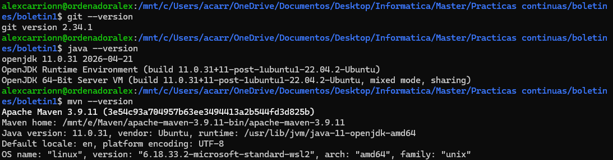
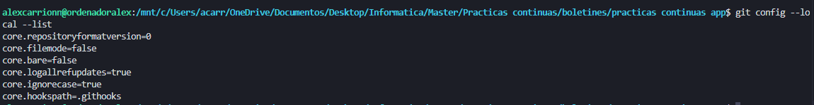
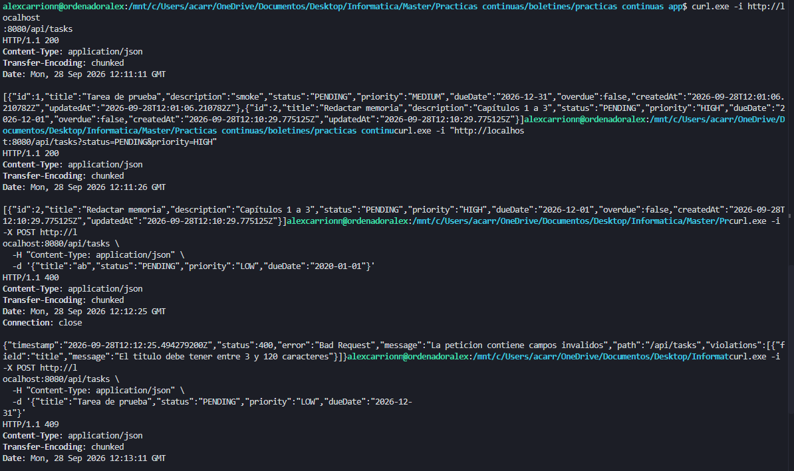
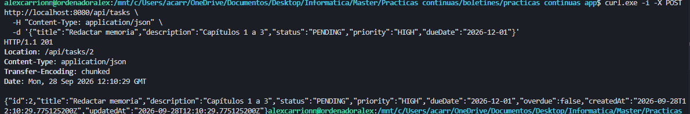
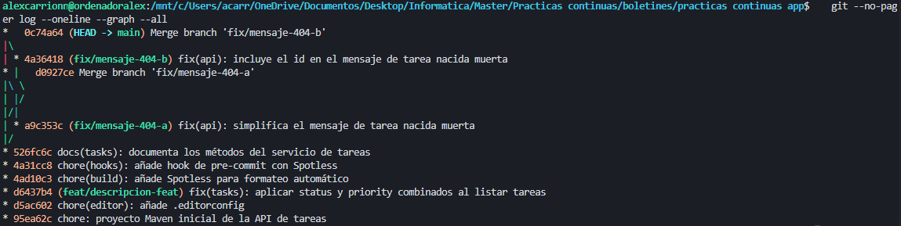
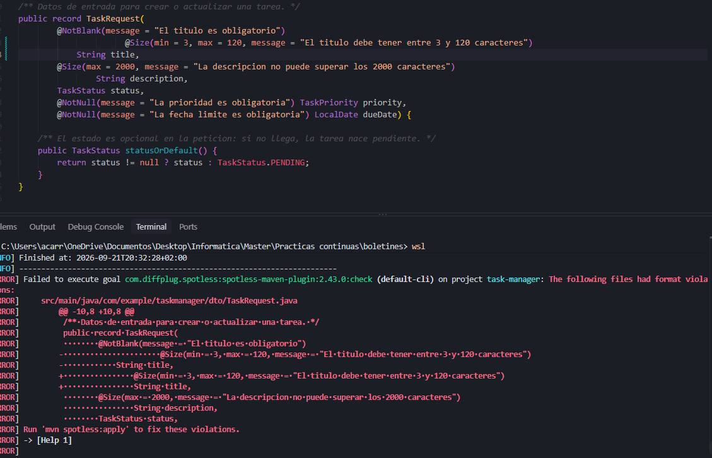
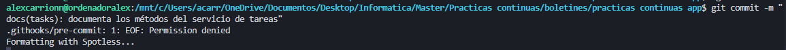
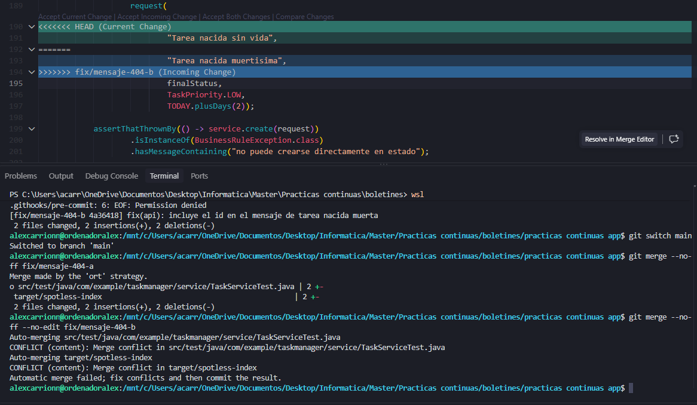

# Boletín 1 · Git y proyecto Maven

**Autor:** Alejandro Carrion Jordan Carrion Jordan
**Modalidad:** individual


## Resumen de commits

| # | Mensaje del commit | Qué se hizo | Autor | Hash|
|---|--------------------|-------------|-------|--------|
| 1 | `chore: proyecto Maven inicial de la API de tareas` | Código generado de la API + `.gitignore` y `.gitattributes` | Alejandro Carrion Jordan | [95ea62c]|
| 2 | `chore(editor): añade .editorconfig` | Configuración común de editores | Alejandro Carrion Jordan | [d5ac602]|
| 3 | `fix(tasks): aplicar status y priority combinados al listar tareas` | Corrección del filtrado combinado en el listado, hecha en la rama `feat/descripcion-feat` e integrada en la rama principal | Alejandro Carrion Jordan | [d6437b4]|
| 4 | `chore(build): añade Spotless para formateo automático` | Plugin Spotless en el `pom.xml` | Alejandro Carrion Jordan | [4ad10c3]|
| 5 | `chore(hooks): añade hook de pre-commit con Spotless` | Hook versionado en `.githooks/` | Alejandro Carrion Jordan | [4a31cc8]|
| 6 | `docs(tasks): documenta los métodos del servicio de tareas` | Javadoc en el servicio escrito con indentación rota para probar el hook | Alejandro Carrion Jordan | [526fc6c] |
| 7 | `fix(api): simplifica el mensaje de tarea nacida muerta` | Rama A del conflicto (`fix/mensaje-404-a`): cambia el mensaje de error | Alejandro Carrion Jordan | [a9c353c] |
| 8 | `fix(api): incluye el id en el mensaje de tarea nacida muerta` | Rama B del conflicto (`fix/mensaje-404-b`): cambia la misma línea de otra forma | Alejandro Carrion Jordan| [4a36418] |
| 9 | `Merge branch 'fix/mensaje-404-a'` | Fusión de la rama A con `--no-ff`, sin conflicto | Alejandro Carrion Jordan | [d0927ce] |
| 10 | `Merge branch 'fix/mensaje-404-b'` | Fusión de la rama B con conflicto resuelto a mano | Alejandro Carrion Jordan| [0c74a64] |

## Detalle por commit

### 1. `chore: proyecto Maven inicial de la API de tareas` (95ea62c)
- **Qué se hizo:** se añade el proyecto Spring Boot generado (entidad `Task`, controlador, servicio, repositorio, manejador de errores y tests), junto con `.gitignore` y `.gitattributes`.
- **Autor:** Alejandro Carrion Jordan
- **Relación con el boletín:** Parte B (generación de la aplicación) y Parte D (inicialización del repositorio).
- **Uso de IA:**. Creacion del proyecto utilizando el siguiente prompt: 
  > Genera un proyecto Maven con Spring Boot 3 y Java 21: una API REST de gestión de tareas (entidad Task con id, título, descripción, estado, prioridad y fecha límite). Usa Spring Data JPA con Hibernate para la persistencia y H2 en memoria como base de datos. Incluye endpoints CRUD, capa de servicio, repositorio JPA, validaciones con Bean Validation, manejo de errores con @RestControllerAdvice y tests unitarios con JUnit 5. 
  Requisitos mínimos de la aplicación para considerarse “no trivial”:
  Al menos una entidad de dominio con varios campos y validaciones.
Persistencia mediante Spring Data JPA/Hibernate.
Operaciones CRUD completas (crear, leer, actualizar, borrar).
Separación en capas (controlador / servicio / repositorio).
Manejo de errores centralizado: un recurso inexistente devuelve 404, no una traza de excepción.
Al menos 5 tests que comprueben reglas de negocio reales (p. ej. “no se puede crear una tarea con fecha límite pasada”), no simples assertNotNull.
No debe incluir tests de integración que levanten el contexto de la aplicación y/o una base de datos. Solo debe incluir tests unitarios.
El proyecto debe generar mediante mvn package un JAR ejecutable (fat JAR) que incluya todas las dependencias y pueda iniciarse mediante java -jar target/<nombre>.jar.


### 2. `chore(editor): añade .editorconfig` (d5ac602)
- **Qué se hizo:** fichero `.editorconfig` con UTF-8, finales de línea LF, indentación de 4 espacios (2 en YAML/JSON) y salto de línea final.
- **Autor:** Alejandro Carrion Jordan
- **Relación con el boletín:** Parte D. Se usa `chore` porque es configuración de herramientas, no código de aplicación.
- **Uso de IA:** no se ha usado (copiado del enunciado).

### 3. `fix(tasks): aplicar status y priority combinados al listar tareas` (d6437b4)
- **Qué se hizo:** al listar tareas filtrando a la vez por `status` y `priority`, ahora se aplican los dos filtros combinados.
- **Autor:** Alejandro Carrion Jordan
- **Relación con el boletín:** Parte D, trabajo en una rama (`feat/descripcion-feat`) e integración en la rama principal.
- **Uso de IA:** herramienta de ayuda para poder editar el código necesario.

### 4. `chore(build): añade Spotless para formateo automático` (4ad10c3)
- **Qué se hizo:** se añade `spotless-maven-plugin` con Google Java Format, eliminación de imports no usados, recorte de espacios finales y salto de línea final.
- **Autor:** Alejandro Carrion Jordan
- **Relación con el boletín:** Parte E.
- **Uso de IA:** no se ha usado (configuración copiada del enunciado).

### 5. `chore(hooks): añade hook de pre-commit con Spotless` (4a31cc8)
- **Qué se hizo:** hook `.githooks/pre-commit` que ejecuta `mvn spotless:apply` y re-añade los ficheros modificados.
- **Autor:** Alejandro Carrion Jordan
- **Relación con el boletín:** Parte E. El hook se guarda en `.githooks/` y no en `.git/hooks/` porque esta última carpeta no se versiona.
- **Uso de IA:** no se ha usado (script copiado del enunciado).

### 6. `docs(tasks): documenta los métodos del servicio de tareas` (526fc6c)
- **Qué se hizo:** se añade Javadoc a los métodos del servicio de tareas, escrito a propósito con la indentación desordenada. Antes del commit, `mvn spotless:check` fallaba; al hacer `git commit`, el hook ejecutó `spotless:apply` y el commit quedó ya formateado (comprobado con `git show`).
- **Autor:** Alejandro Carrion Jordan Carrion Jordan
- **Relación con el boletín:** Parte E, verificación del hook. El cambio incluye contenido real (el Javadoc) porque un commit que solo cambiara la indentación quedaría vacío tras el formateo y Git lo rechazaría.
- **Uso de IA:** no se ha usado.

### 7. `fix(api): simplifica el mensaje de tarea nacida muerta` (a9c353c)
- **Qué se hizo:** en la rama `fix/mensaje-404-a`, creada desde `main`, se cambia el mensaje de error del fichero `"TaskServiceTest.java"` de por `"Tarea nacida sin vida"`.
- **Autor:** Alejandro Carrion Jordan Carrion Jordan
- **Relación con el boletín:** Parte F, primera de las dos ramas que modifican la misma línea.
- **Uso de IA:** no se ha usado.

### 8. `fix(api): incluye el id en el mensaje de tarea nacida muerta` (4a36418)
- **Qué se hizo:** en la rama `fix/mensaje-404-b`, también creada desde `main`, se modifica esa misma línea de otra forma: `"Tarea nacia muertisima"`.
- **Autor:** Alejandro Carrion Jordan Carrion Jordan
- **Relación con el boletín:** Parte F.
- **Uso de IA:** no se ha usado.

### 9. `Merge branch 'fix/mensaje-404-a'` (d0927ce)
- **Qué se hizo:** fusión de `fix/mensaje-404-a` en `main` con `git merge --no-ff`. No hay conflicto porque `main` no había cambiado esa línea. Se usa `--no-ff` para que se genere un commit de merge y la rama quede visible en el grafo, a diferencia del fast-forward de la Parte D.
- **Autor:** Alejandro Carrion Jordan Carrion Jordan
- **Relación con el boletín:** Parte F.
- **Uso de IA:** no se ha usado.

### 10. `Merge branch 'fix/mensaje-404-b'` (0c74a64)
- **Qué se hizo:** fusión de `fix/mensaje-404-b` en `main`. Como `main` ya contenía el cambio de la rama A en la misma línea, Git no puede decidir cuál conservar y marca conflicto en `TaskServiceTest.java`. Se resolvió a mano eliminando los marcadores `<<<<<<<`, `=======` y `>>>>>>>` y dejando el mensaje de uno. Después se comprobó con `mvn clean package` que compilaba y los tests pasaban, y se cerró con `git add` y `git commit`.
- **Autor:** Alejandro Carrion Jordan Carrion Jordan
- **Relación con el boletín:** Parte F, resolución de conflictos.
- **Uso de IA:** no se ha usado.

## Descripción narrativa de la sesión

### Parte A · Instalación y verificación del entorno





### Parte C · Construcción y prueba en local


```bash
java -jar target/nombre-del-jar-gordo.jar

# En otra terminal:
curl ... # prueba los endpoints de la API
```





### Parte D · Control de versiones con Git

Se añadieron `.gitignore` (evita versionar artefactos de compilación y ficheros del IDE), `.gitattributes` (normaliza los finales de línea a LF para que los scripts funcionen en contenedores Linux) y `.editorconfig` (misma indentación y codificación en todos los editores).

Después se creó la rama `feat/descripcion-feat` y en ella se hizo el commit `d6437b4`, que corrige el filtrado combinado por `status` y `priority`. Al fusionarla con `git merge`, Git hizo un **fast-forward**: como la rama principal no había avanzado desde que se creó la rama, bastó con mover el puntero de la rama principal al commit de la rama y no se generó commit de merge. Por eso el historial es lineal.



Relación con los commits: 1, 2 y 3.

### Parte E · Formateo automático con Spotless

<Diferencia entre `spotless:check` y `spotless:apply`, cómo funciona el hook, por qué va en `.githooks/` y por qué no sustituye a la CI (se puede saltar con `--no-verify`).>




Relación con los commits: 4, 5 y 6.

### Parte F · Conflicto y resolución

Desde `main` se crearon dos ramas, `fix/mensaje-404-a` y `fix/mensaje-404-b`, que modifican la misma línea de `TaskServiceTest.java`: el mensaje que devuelve la API cuando una tarea no existe. La primera fusión (d0927ce) se completó sin problemas. En la segunda (0c74a64), Git detectó que ambas ramas habían cambiado la misma línea respecto al ancestro común y paró la fusión marcando el conflicto.

Para resolverlo se revisó el estado con `git status`, se editó el archivo quitando los marcadores y se dejó una versión final <que combina ambas / que conserva la de la rama X>. Al final se cerró la fusión con `git add` y `git commit`.

En el grafo final se ven las dos ramas saliendo de `526fc6c` y volviendo a `main` mediante sus commits de merge.




Relación con los commits: 7, 8, 9 y 10.

## Uso de IA en la sesión

| Herramienta | Para qué se usó | Commits afectados |
|---|---|---|
| Claude | Generación del proyecto inicial | 1 |
| Claude | Ayuda en la redacción de la documentación | 0 |

