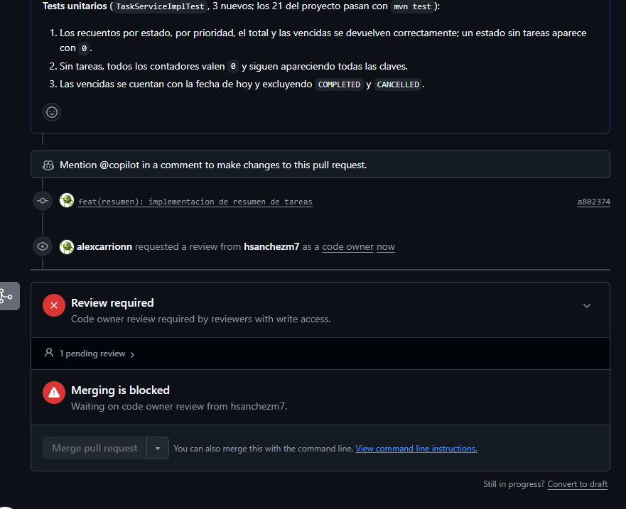
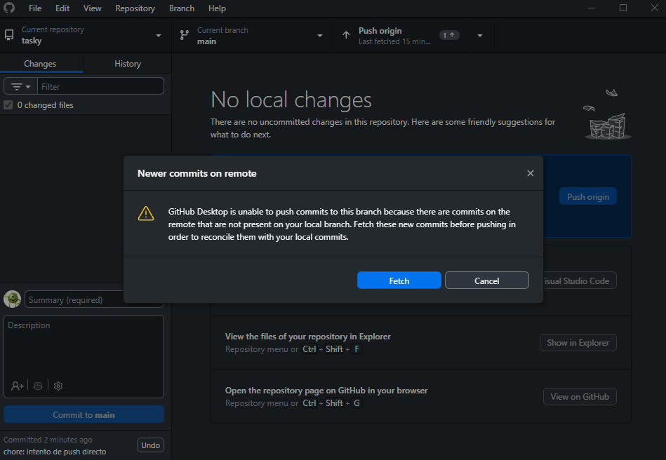
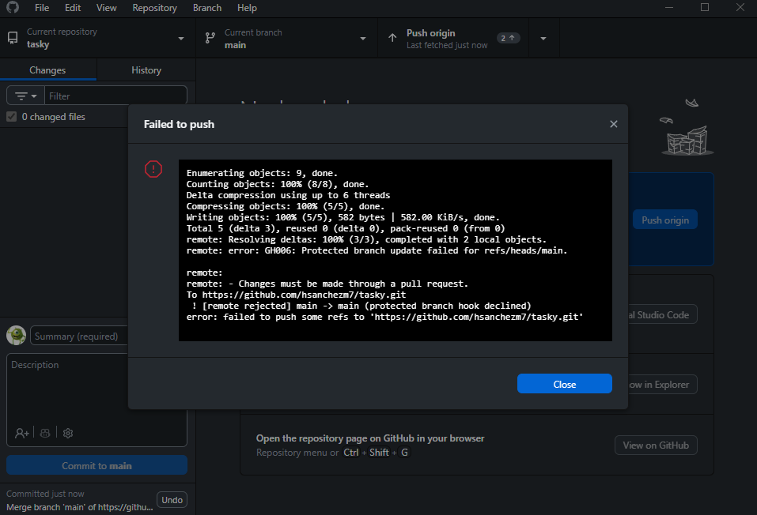
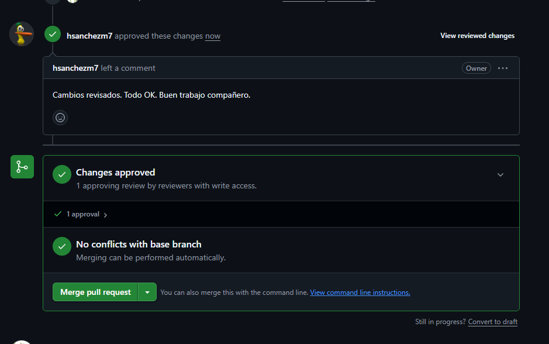
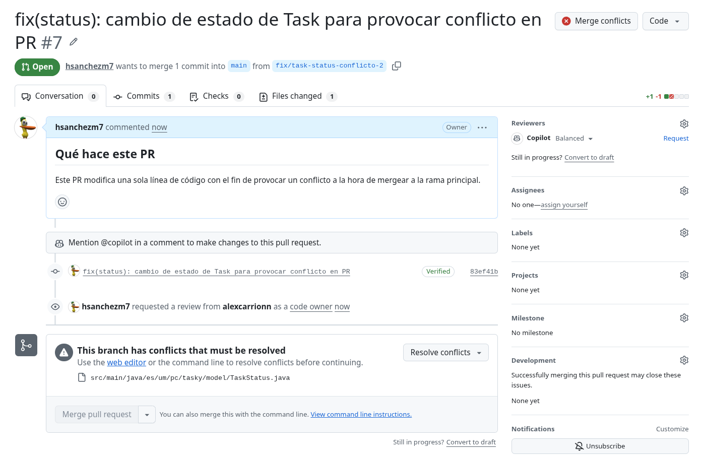
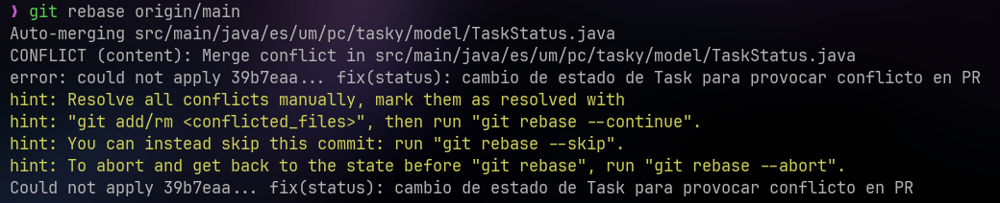
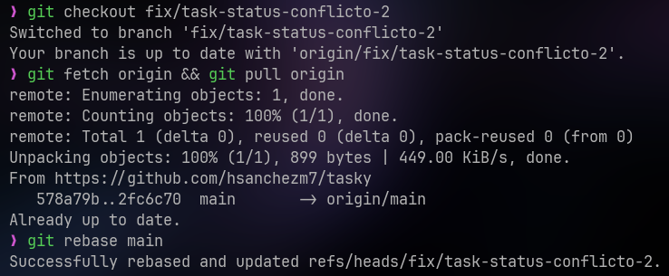
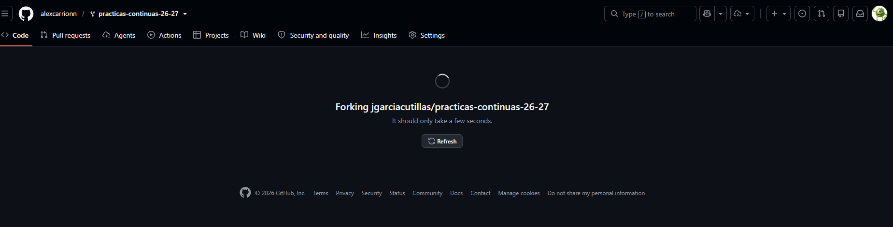
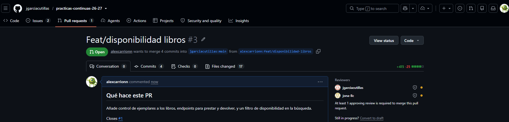
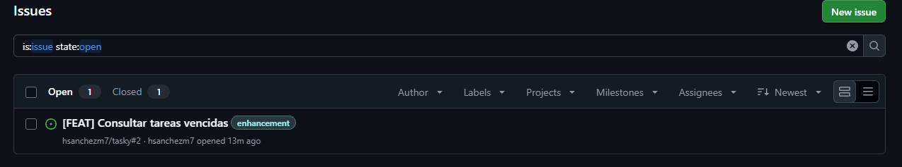

# Boletín 2

## Resumen de commits

| # | Mensaje del commit | Qué se hizo | Autor | Enlace |
|---|--------------------|-------------|-------|--------|
| 1 | `docs(readme): actualizar README para boletín 2` | Redacción completa del `README.md` (155 líneas): descripción, requisitos, puesta en marcha desde cero, activación de los hooks del Boletín 1, documentación de la API y convenciones. | Hugo Sánchez | [e4e8b14](https://github.com/hsanchezm7/tasky/commit/e4e8b14c4474556692b9845f8209b16c1eb8e489) |
| 2 | `chore: add CODEOWNERS y plantilla PR` | Creación de `.github/CODEOWNERS` asignando la revisión de todo el repositorio a los dos integrantes y de `.github/PULL_REQUEST_TEMPLATE.md` con la plantilla de Pull Request. | Hugo Sánchez | [e617602](https://github.com/hsanchezm7/tasky/commit/e617602b960a9a3d6fc39b90e3db608c9954f97f) |
| 3 | `chore(github): añade plantillas de issues` | Creación de cuatro plantillas de Issue (`bug_report`, `feature_request`, `documentation`, `task`) con etiquetas y asignatarios automáticos, más `config.yml` para desactivar los issues en blanco y enlazar a Discussions. | Alejandro Carrión | [95c8399](https://github.com/hsanchezm7/tasky/commit/95c83992baca3d131afa8378d62c1d71d3c135f9) |
| 4 | `chore(gh): add CONTRIBUTING.md para guiar en la contribución` | Redacción de `.github/CONTRIBUTING.md` (106 líneas) con requisitos del entorno, activación de hooks, política de uso de IA, flujo de ramas, convención de commits, estándares de test y proceso de revisión de PR. | Hugo Sánchez | [88717e5](https://github.com/hsanchezm7/tasky/commit/88717e582b77136f8ca72a6d752e556ba2006d64) |
| 5 | `feat(resumen): implementacion de resumen de tareas` | Endpoint `GET /api/tasks/stats` con DTO `TaskStatsResponse`, contadores por estado y prioridad, contador de vencidas y 3 tests unitarios nuevos. | Alejandro Carrión | [a802374](https://github.com/hsanchezm7/tasky/commit/a8023744ddf564c2b6f4bf47b98abe6670d22f29) |
| 6 | `feat(resumen): implementacion de resumen de tareas (#3)` | Commit de fusión del **[PR #3](https://github.com/hsanchezm7/tasky/pull/3)** en `main` tras la revisión y aprobación. | Alejandro Carrión | [434f5b0](https://github.com/hsanchezm7/tasky/commit/434f5b09d779463b386c1bfc9ce1f37c9daa9317) |
| 7 | `feat(tasks): add endpoint GET /api/tasks/overdue para tareas vencidas` | Endpoint `GET /api/tasks/overdue` que lista las tareas vencidas aún abiertas, con método de consulta en el repositorio y 2 tests unitarios nuevos. | Hugo Sánchez | [c63149c](https://github.com/hsanchezm7/tasky/commit/c63149c7621a300e4d0dd9ba474a2b9860f85e9d) |
| 8 | `feat(tasks): add endpoint GET /api/tasks/overdue para tareas vencidas (#4)` | Commit de fusión del **[PR #4](https://github.com/hsanchezm7/tasky/pull/4)** en `main` tras la revisión y aprobación. | Alejandro Carrión | [578a79b](https://github.com/hsanchezm7/tasky/commit/578a79b662aee2e3a4db3cf55b148fd1e6137cfb) |
| 9 | `fix(status): cambio para pr con conflicto` | Rama A del conflicto: renombra la constante `CANCELLED` del enum `TaskStatus` a `CANCELADA`. | Alejandro Carrión | [762d5e0](https://github.com/hsanchezm7/tasky/commit/762d5e012603098119da23dfa3e2639c7bdc1e59) |
| 10 | `fix(status): cambio para pr con conflicto (#6)` | Commit de fusión del **[PR #6](https://github.com/hsanchezm7/tasky/pull/6)**, el primero de los dos del conflicto. Se fusiona sin incidencias. | Hugo Sánchez | [2fc6c70](https://github.com/hsanchezm7/tasky/commit/2fc6c70775d47f98cc6f42f04fc214c40107bd27) |
| 11 | `fix(status): cambio de estado de Task para provocar conflicto en PR` | Rama B del conflicto: modifica **la misma línea** de `TaskStatus` cambiándola a `SUSPENDED`. Commit reescrito por el `git rebase` sobre `main` que resolvió el conflicto. | Hugo Sánchez | [f3e7f9a](https://github.com/hsanchezm7/tasky/commit/f3e7f9a3bf2d98446045e586c942b3cdbd88d768) |
| 12 | `fix(status): cambio de estado de Task para provocar conflicto en PR (#7)` | Commit de fusión del **[PR #7](https://github.com/hsanchezm7/tasky/pull/7)** una vez rebasada la rama y desaparecido el conflicto en GitHub. | Alejandro Carrión | [66c3f58](https://github.com/hsanchezm7/tasky/commit/66c3f58d7191c230d0062f297466e4d466885f29) |

## Detalle por commit

### 1. `docs(readme): actualizar README para boletín 2`

- **Qué se hizo:** Redacción completa del `README.md` documentando la descripción del proyecto, requisitos (Git, JDK 21, Maven), puesta en marcha con activación de hooks del Boletín 1, ejemplos de peticiones `curl` y especificación de la API.

- **Autor:** Hugo Sánchez

- **Relación con el boletín:** Apartado **Parte A** (Publicar el repositorio y completar el `README.md`).

### 2. `chore: add CODEOWNERS y plantilla PR`

- **Qué se hizo:**

  - Creación de `.github/CODEOWNERS` con una regla global que asigna la revisión de **todo** el repositorio a los dos integrantes de la pareja:

    ```
    # Toda la aplicación la revisa el equipo
    *               @hsanchezm7 @alexcarrionn
    ```

    Se optó deliberadamente por una regla global en lugar de repartir rutas (`src/path1/**`, `src/path2/**`) entre propietarios distintos, porque en un proyecto de dos personas ambas deben conocer la totalidad del código.

  - Creación de `.github/PULL_REQUEST_TEMPLATE.md`, que GitHub carga automáticamente en el cuerpo de cada Pull Request nuevo, con tres secciones: qué hace el PR (con el `Closes #` para enlazar el Issue), cómo se ha probado (checklist de tests unitarios y de prueba manual con `curl`) y notas para quien revise.

- **Autor:** Hugo Sánchez

- **Relación con el boletín:** Apartado **Parte B** (Gobernanza del repositorio — plantilla de PR y fichero `CODEOWNERS`). El `CODEOWNERS` es además requisito de la **Parte C**, porque la regla de protección de `main` activa *Require review from Code Owners*, que sin este fichero no tendría efecto.

### 3. `chore(github): añade plantillas de issues`

- **Qué se hizo:**

  - Investigación previa del funcionamiento de las plantillas y etiquetas de Issue de GitHub: los ficheros situados en `.github/ISSUE_TEMPLATE/` se ofrecen como opciones al pulsar *New issue*, y su cabecera YAML (`name`, `about`, `title`, `labels`, `assignees`) permite prefijar el título, aplicar etiquetas y asignar responsables automáticamente.

  - Creación de **cuatro plantillas**, ampliando las dos exigidas por el enunciado:

    - `bug_report.md` — etiquetas `bug` y `triage`, título prefijado `[BUG] `, asignación automática, y secciones de descripción, pasos para reproducir, comportamiento esperado y comportamiento actual (con la petición `curl`, el código HTTP y el JSON de error devuelto).

    - `feature_request.md` — etiqueta `enhancement`, título prefijado `[FEAT] `, con el problema que resuelve y una casilla de prioridad.

    - `documentation.md` — para incidencias de documentación.

    - `task.md` — para tareas de mantenimiento del repositorio.

  - Creación de `.github/ISSUE_TEMPLATE/config.yml` con `blank_issues_enabled: false`, de modo que **no se puedan abrir issues en blanco** y todo el mundo pase por una plantilla, más un enlace de contacto que redirige las dudas generales a Discussions.

- **Autor:** Alejandro Carrión Jordán

- **Relación con el boletín:** Apartado **Parte B** (Gobernanza del repositorio — investigar y crear plantillas y etiquetas de Issue).

### 4. `chore(gh): add CONTRIBUTING.md para guiar en la contribución`

- **Qué se hizo:**

  - Redacción de `.github/CONTRIBUTING.md`, guía completa para cualquier persona que quiera contribuir al proyecto, organizada en seis secciones:

    1. **Requisitos del entorno**, en forma de tabla con la versión exigida de cada herramienta y el comando para comprobarla.

    2. **Configuración inicial del repositorio**, marcando como obligatorio activar los hooks versionados tras clonar (`git config core.hooksPath .githooks` y `chmod +x`), y explicando qué hace el hook `pre-commit` (ejecutar Spotless con `google-java-format` e indexar los ficheros reformateados) y cómo formatear a mano con `mvn spotless:apply`.

    3. **Uso de Inteligencia Artificial**, permitido pero sujeto a revisión y declaración transparente, en coherencia con lo exigido por la asignatura.

    4. **Flujo de trabajo con Git y GitHub**: cómo reportar problemas mediante Issues, nomenclatura de ramas de trabajo y convención de commits.

    5. **Estándares de desarrollo y pruebas**: arquitectura por capas, reglas de negocio y exigencia de tests unitarios.

    6. **Envío y revisión de Pull Requests**, con la política de fusión del repositorio.

- **Autor:** Hugo Sánchez

- **Relación con el boletín:** Apartado **Parte B** (Gobernanza del repositorio — generar un `CONTRIBUTING.md` con todo lo que necesita saber quien quiera contribuir: cómo contribuir, política de fusión, puesta en marcha del entorno y hooks).

### 5. `feat(resumen): implementacion de resumen de tareas`

- **Qué se hizo:**

  - Creación de la rama de funcionalidad a partir de `main` para resolver el **[Issue #1](https://github.com/hsanchezm7/tasky/issues/1)** e implementar un endpoint de estadísticas agregadas.

  - Nuevo DTO de salida `TaskStatsResponse` con cuatro campos: `total`, `byStatus` (`Map<TaskStatus, Long>`), `byPriority` (`Map<TaskPriority, Long>`) y `overdue`. Se documenta explícitamente que los mapas incluyen **todos** los valores de cada enum, también los que tienen 0 tareas, para que el consumidor de la API reciba siempre las mismas claves.

  - Ampliación de `TaskRepository` con tres métodos derivados de Spring Data: `countByStatus`, `countByPriority` y `countByDueDateBeforeAndStatusNotIn`.

  - Implementación de `getStats()` en `TaskServiceImpl`, recorriendo los valores de cada enum sobre un `EnumMap` para garantizar claves completas y orden estable. El contador de vencidas usa `LocalDate.now()` y excluye con un `EnumSet` los estados cerrados (`COMPLETED` y `CANCELLED`), de forma que una tarea que vence **hoy** no se considera vencida.

  - Nuevo endpoint `GET /api/tasks/stats` en `TaskController` delegando en el servicio.

  - Tres tests unitarios nuevos en `TaskServiceImplTest`, sin levantar el contexto de Spring: el recuento por estado, prioridad y vencidas; el caso sin tareas, que debe devolver todos los contadores a 0 **conservando todas las claves**; y la comprobación de que las vencidas se cuentan desde hoy excluyendo `COMPLETED` y `CANCELLED`.

  - Actualización del `README.md` documentando el nuevo endpoint.

- **Autor:** Alejandro Carrión Jordán

- **Relación con el boletín:** Apartado **Parte D** (Trabajo por Pull Requests — primer ciclo completo: Issue, rama de feature, implementación con tests, push y PR). Alejandro abre el PR y Hugo lo revisa.

### 6. `feat(resumen): implementacion de resumen de tareas (#3)`

- **Qué se hizo:**

  - Fusión en `main` del **[PR #3](https://github.com/hsanchezm7/tasky/pull/3)** una vez aprobado por el revisor, generando un **commit de fusión** con dos padres (`88717e5` y `a802374`). El mensaje reproduce el título del PR seguido de su número, por la opción de mensaje de merge configurada en el repositorio.

  - Borrado de la rama de feature tras la fusión.

- **Autor:** Alejandro Carrión Jordán (`alexcarrionn`, fusión realizada desde la interfaz web de GitHub)

- **Relación con el boletín:** Apartado **Parte D** (último paso del ciclo: fusionar el PR con la estrategia elegida y borrar la rama).

### 7. `feat(tasks): add endpoint GET /api/tasks/overdue para tareas vencidas`

- **Qué se hizo:**

  - Creación de la rama de funcionalidad a partir de `main` para resolver el **[Issue #2](https://github.com/hsanchezm7/tasky/issues/2)**, esta vez con los roles intercambiados.

  - Nuevo método `findByDueDateBeforeAndStatusNotIn(LocalDate, Collection<TaskStatus>)` en `TaskRepository`, reutilizando el criterio de "tarea vencida" ya introducido en el PR anterior.

  - Implementación de `getOverdueTasks()` en `TaskServiceImpl` con la misma semántica que el contador del resumen (fecha actual y exclusión de `COMPLETED` y `CANCELLED`), manteniendo así una única definición de negocio para ambos endpoints.

  - Nuevo endpoint `GET /api/tasks/overdue` en `TaskController`, que mapea las entidades a `TaskResponse` antes de devolverlas.

  - Dos tests unitarios nuevos en `TaskServiceImplTest` que verifican con Mockito que el servicio delega en el repositorio con la fecha actual y los estados cerrados excluidos, y el caso en el que no hay tareas vencidas.

- **Autor:** Hugo Sánchez

- **Relación con el boletín:** Apartado **Parte D** (segundo ciclo completo de PR, con los roles invertidos: ahora Hugo abre el PR y Alejandro lo revisa).

### 8. `feat(tasks): add endpoint GET /api/tasks/overdue para tareas vencidas (#4)`

- **Qué se hizo:**

  - Fusión en `main` del **[PR #4](https://github.com/hsanchezm7/tasky/pull/4)** tras la revisión y aprobación, generando el commit de fusión con padres `434f5b0` y `c63149c`, y borrado de la rama.

- **Autor:** Alejandro Carrión Jordán (`alexcarrionn`, fusión realizada desde la interfaz web de GitHub)

- **Relación con el boletín:** Apartado **Parte D** (cierre del segundo ciclo de PR).

### 9. `fix(status): cambio para pr con conflicto`

- **Qué se hizo:**

  - Creación de la primera de las dos ramas destinadas a provocar un conflicto, partiendo de `main` (`578a79b`).

  - Modificación de la **última constante del enum** `TaskStatus`, renombrando `CANCELLED` a `CANCELADA`. Se eligió esta línea por ser un punto de cambio pequeño, inequívoco y compartido por ambas ramas.

- **Autor:** Alejandro Carrión Jordán

- **Relación con el boletín:** Apartado **Parte E** (Provocar un conflicto en un PR — primera rama).

### 10. `fix(status): cambio para pr con conflicto (#6)`

- **Qué se hizo:**

  - Fusión en `main` del **[PR #6](https://github.com/hsanchezm7/tasky/pull/6)**. Al ser el primero de los dos, se fusiona sin ningún conflicto: `main` no había tocado esa línea desde que la rama se creó.

- **Autor:** Hugo Sánchez (fusión realizada desde la interfaz web de GitHub)

- **Relación con el boletín:** Apartado **Parte E** (fusionar la primera rama vía PR).

### 11. `fix(status): cambio de estado de Task para provocar conflicto en PR`

- **Qué se hizo:**

  - Creación de la segunda rama, también a partir de `578a79b`, modificando **la misma línea** del enum `TaskStatus` de forma distinta: `CANCELLED` → `SUSPENDED`.

  - Al abrir el PR, GitHub detectó el conflicto y bloqueó el botón de fusión, porque `main` ya contenía el cambio de la rama A sobre esa misma línea.

  - Resolución **en local mediante `git rebase` sobre `main`**: durante el rebase Git detuvo el proceso en el commit conflictivo, se editó `TaskStatus.java` eliminando los marcadores y dejando `SUSPENDED` como valor final, y se continuó con `git rebase --continue`.

  - Publicación de la rama reescrita con `git push --force-with-lease`. Tras el push, GitHub actualizó el PR automáticamente y el conflicto desapareció.

  - La reescritura del historial es visible en el propio grafo: este commit tiene como padre `2fc6c70` (el merge del PR #6), y no `578a79b`, que era el punto de partida original de la rama.

- **Autor:** Hugo Sánchez

- **Relación con el boletín:** Apartado **Parte E** (segunda rama, conflicto en el PR y resolución mediante rebase sobre `main`).

### 12. `fix(status): cambio de estado de Task para provocar conflicto en PR (#7)`

- **Qué se hizo:**

  - Fusión en `main` del **[PR #7](https://github.com/hsanchezm7/tasky/pull/7)** una vez resuelto el conflicto y aprobada la revisión. El estado final del enum `TaskStatus` en `main` es `PENDING`, `IN_PROGRESS`, `COMPLETED`, `SUSPENDED`.

- **Autor:** Alejandro Carrión Jordán (`alexcarrionn`, fusión realizada desde la interfaz web de GitHub)

- **Relación con el boletín:** Apartado **Parte E** (fusión del PR tras la resolución del conflicto).

## Descripción narrativa de lo hecho en la sesión y relación con los commits

### Parte A — Publicar el repositorio

Se creó en GitHub el repositorio público y vacío [hsanchezm7/tasky](https://github.com/hsanchezm7/tasky), sin README ni ningún otro fichero inicial, para que el primer push del repositorio local del Boletín 1 no generase conflictos. Hugo Sánchez, como creador, dio de alta a `alexcarrionn` como colaborador con permisos de escritura.

A continuación se conectó el repositorio local con el remoto y se subió el historial completo del Boletín 1:

```bash
git remote add origin https://github.com/hsanchezm7/tasky.git
git branch -M main
git push -u origin main
```

Los cuatro commits del Boletín 1 (`9e306f5`, `c455a1d`, `fbdf7c1` y `0eb594a`) quedaron así publicados en `main`.

Por último se redactó el `README.md` completo, documentando la puesta en marcha desde cero: requisitos, clonado, **activación de los hooks del Boletín 1** (paso imprescindible, porque `core.hooksPath` es configuración local y no viaja con el repositorio), construcción, arranque del fat JAR y comprobación con `curl`.

- **Commit 1:** `docs(readme): actualizar README para boletín 2` ([e4e8b14](https://github.com/hsanchezm7/tasky/commit/e4e8b14c4474556692b9845f8209b16c1eb8e489)).

### Parte B — Gobernanza del repositorio

Antes de abrir el primer PR se dejó el repositorio preparado para que colaborar fuese sencillo y las revisiones se solicitasen solas.

1. **Plantilla de Pull Request.** Se creó `.github/PULL_REQUEST_TEMPLATE.md`. GitHub la reconoce por su ubicación y la precarga en el cuerpo de todo PR nuevo, lo que garantiza que ninguno se abra sin explicar qué hace, cómo se ha probado y qué debe mirar quien revise.

2. **Propietarios del código.** Se creó `.github/CODEOWNERS` con la regla global `* @hsanchezm7 @alexcarrionn`. Con ella, GitHub solicita **automáticamente** la revisión de ambos en cualquier PR. Se valoró repartir rutas entre propietarios distintos, pero en una pareja interesa que los dos conozcan todo el código.

3. **Plantillas y etiquetas de Issue.** Se investigó el mecanismo de plantillas de Issue y se crearon cuatro (`bug_report`, `feature_request`, `documentation` y `task`), cada una con su cabecera YAML que prefija el título y **aplica etiquetas automáticamente** (`bug`, `triage`, `enhancement`…), de modo que la clasificación no dependa de que nadie se acuerde de etiquetar a mano. Además, `config.yml` desactiva los issues en blanco y redirige las dudas generales a Discussions.

4. **Estrategia de fusión.** Se revisaron las tres opciones que ofrece GitHub en *Settings → General → Pull Requests*:

   | Estrategia | Qué hace | Cuándo interesa |
   |---|---|---|
   | **Merge commit** | Conserva todos los commits de la rama y añade un commit de fusión con dos padres. | Historial completo y trazable; el grafo muestra las ramas. |
   | **Squash and merge** | Aplasta toda la rama en un único commit sobre `main`. | Historial lineal y limpio, a costa de perder el detalle. |
   | **Rebase and merge** | Reaplica los commits sobre `main` sin commit de fusión. | Historial lineal conservando los commits. |

   No se ha elegido una estrategia única en concreto, sino que se ha permitido tanto el uso de **Merge commit** como de **Rebase and merge**, desactivando la opción de **Squash and merge**. No creemos conveniente combinar todos los cambios en un solo commit, ya que se perdería el detalle y la trazabilidad de los commits individuales realizados a lo largo de cada rama.

5. **Guía de contribución.** Se redactó `.github/CONTRIBUTING.md` reuniendo todo lo que necesita saber quien llegue nuevo: requisitos del entorno, activación obligatoria de los hooks, política de uso de IA, flujo de ramas, convención de commits, estándares de test y proceso de revisión de PR.

Tras el push se comprobó en GitHub que las plantillas y los propietarios del código se reconocían correctamente: la plantilla aparece precargada al abrir un PR, las de Issue se ofrecen como opciones en *New issue* y los revisores se solicitan solos.

- **Commit 2:** `chore: add CODEOWNERS y plantilla PR` ([e617602](https://github.com/hsanchezm7/tasky/commit/e617602b960a9a3d6fc39b90e3db608c9954f97f)).
- **Commit 3:** `chore(github): añade plantillas de issues` ([95c8399](https://github.com/hsanchezm7/tasky/commit/95c83992baca3d131afa8378d62c1d71d3c135f9)).
- **Commit 4:** `chore(gh): add CONTRIBUTING.md para guiar en la contribución` ([88717e5](https://github.com/hsanchezm7/tasky/commit/88717e582b77136f8ca72a6d752e556ba2006d64)).



### Parte C — Proteger la rama `main`

Se añadió una regla de protección sobre `main` con las siguientes condiciones, y una explicación de qué consigue cada una:

| Regla | Qué conseguimos |
|---|---|
| *Require a pull request before merging* | Ningún cambio entra en `main` sin pasar por un PR: siempre hay un punto de discusión y un diff revisable. |
| *Require at least 1 approval* | Todo cambio ha sido leído por alguien distinto de quien lo escribió. |
| *Require review from Code Owners* | La aprobación no vale de cualquiera: tiene que venir de quien figura en `CODEOWNERS`. |
| *Require conversation resolution before merging* | No se fusiona dejando comentarios de revisión sin responder ni cerrar. |
| *Dismiss stale approvals when new commits are pushed* | Si tras la aprobación se suben más commits, la aprobación caduca; impide colar código no revisado en un PR ya aprobado. |
| *Do not allow bypassing the above settings* | La regla se aplica también a los administradores del repositorio, que si no podrían saltársela. |
| Sin *force push* ni borrado de `main` | El historial de `main` es inmutable: nadie puede reescribirlo ni eliminar la rama. |

En conjunto, estas reglas convierten `main` en una rama en la que **solo se puede entrar por la puerta principal**: a través de un PR revisado, aprobado por un propietario del código y con todas las conversaciones cerradas.

Para comprobar que la protección funciona de verdad, se intentó un push directo:

```bash
git switch main
echo "prueba" >> README.md
git commit -am "chore: intento de push directo"
git push          # RECHAZADO por el servidor
```

El servidor rechazó el push con un error de tipo *protected branch hook declined*. Conviene destacar que **este commit no aparece en el historial del repositorio**: el commit se llegó a crear en local, pero al no poder subirse nunca llegó al remoto, y posteriormente se deshizo en local. Por eso esta parte se documenta con capturas y no con un enlace a un commit.





### Parte D — Trabajo por Pull Requests

Se realizaron dos ciclos completos de PR, cada uno aportando una mejora real a la API, y con los roles intercambiados entre ambos ciclos.

**Ciclo 1 — Resumen de tareas ([PR #3](https://github.com/hsanchezm7/tasky/pull/3)).** Se abrió el **[Issue #1](https://github.com/hsanchezm7/tasky/issues/1)** con la plantilla de *feature request* describiendo la necesidad de un endpoint de estadísticas. Alejandro creó la rama de feature, implementó `GET /api/tasks/stats` con el DTO `TaskStatsResponse` (total, desglose por estado y por prioridad, y número de tareas vencidas) y añadió tres tests unitarios, incluido el caso límite de una base vacía que debe devolver todos los contadores a cero conservando todas las claves de los enums. Subió la rama, abrió el PR usando la plantilla enlazando el Issue con `Closes #1`, y Hugo lo revisó y aprobó. Se fusionó y se borró la rama.

**Ciclo 2 — Tareas vencidas ([PR #4](https://github.com/hsanchezm7/tasky/pull/4)).** Con los roles invertidos, se abrió el **[Issue #2](https://github.com/hsanchezm7/tasky/issues/2)** y Hugo implementó `GET /api/tasks/overdue`, que devuelve la lista de tareas vencidas aún abiertas. La implementación reutiliza el mismo criterio de negocio que el contador del resumen (fecha actual y exclusión de `COMPLETED` y `CANCELLED`), de modo que ambos endpoints no puedan divergir. Se añadieron dos tests unitarios con Mockito. Alejandro revisó y aprobó el PR, que se fusionó y cuya rama se borró.

- **Commit 5:** `feat(resumen): implementacion de resumen de tareas` ([a802374](https://github.com/hsanchezm7/tasky/commit/a8023744ddf564c2b6f4bf47b98abe6670d22f29)).
- **Commit 6:** fusión del PR #3 ([434f5b0](https://github.com/hsanchezm7/tasky/commit/434f5b09d779463b386c1bfc9ce1f37c9daa9317)).
- **Commit 7:** `feat(tasks): add endpoint GET /api/tasks/overdue` ([c63149c](https://github.com/hsanchezm7/tasky/commit/c63149c7621a300e4d0dd9ba474a2b9860f85e9d)).
- **Commit 8:** fusión del PR #4 ([578a79b](https://github.com/hsanchezm7/tasky/commit/578a79b662aee2e3a4db3cf55b148fd1e6137cfb)).



### Parte E — Provocar un conflicto en un PR

Se crearon dos ramas a partir del mismo punto de `main` (`578a79b`) que modifican **la misma línea** del fichero `src/main/java/es/um/pc/tasky/model/TaskStatus.java`, concretamente la última constante del enum:

| Rama | Autor | Cambio sobre esa línea |
|---|---|---|
| A ([PR #6](https://github.com/hsanchezm7/tasky/pull/6)) | Alejandro | `CANCELLED` → `CANCELADA` |
| B ([PR #7](https://github.com/hsanchezm7/tasky/pull/7)) | Hugo | `CANCELLED` → `SUSPENDED` |

El **PR #6** se fusionó primero y sin incidencias, porque `main` no había tocado esa línea desde que la rama se creó.

Al abrir el **PR #7**, GitHub mostró el aviso de conflicto y bloqueó la fusión: la rama seguía partiendo de un `main` anterior en el que la línea aún decía `CANCELLED`, mientras que `main` ya decía `CANCELADA`. Git no puede decidir por su cuenta cuál de los dos cambios debe prevalecer.

La resolución se hizo en local mediante un **rebase sobre `main`**:

```bash
git switch fix/task-status-conflicto-2
git fetch origin
git rebase origin/main
# Git detiene el rebase en el commit conflictivo:
# editar TaskStatus.java, quitar los marcadores <<<<<<< ======= >>>>>>>
# y dejar SUSPENDED como valor final
git add src/main/java/es/um/pc/tasky/model/TaskStatus.java
git rebase --continue
git push --force-with-lease
```

El `--force-with-lease` es necesario porque el rebase **reescribe** los commits de la rama: dejan de ser los mismos objetos que hay en el remoto, y un push normal sería rechazado. Frente a un `--force` a secas, esta variante aborta el push si alguien hubiera subido algo a la rama mientras tanto, evitando pisar trabajo ajeno.

Tras el push, GitHub actualizó el PR automáticamente, el aviso de conflicto desapareció y el botón de fusión volvió a estar disponible. El efecto del rebase queda registrado en el propio grafo del repositorio: el commit `f3e7f9a` tiene como padre `2fc6c70` (la fusión del PR #6) en lugar de `578a79b`, que era el punto de partida original de la rama. El estado final del enum en `main` es `PENDING`, `IN_PROGRESS`, `COMPLETED`, `SUSPENDED`.

- **Commit 9:** rama A del conflicto ([762d5e0](https://github.com/hsanchezm7/tasky/commit/762d5e012603098119da23dfa3e2639c7bdc1e59)).
- **Commit 10:** fusión del PR #6 ([2fc6c70](https://github.com/hsanchezm7/tasky/commit/2fc6c70775d47f98cc6f42f04fc214c40107bd27)).
- **Commit 11:** rama B, ya rebasada ([f3e7f9a](https://github.com/hsanchezm7/tasky/commit/f3e7f9a3bf2d98446045e586c942b3cdbd88d768)).
- **Commit 12:** fusión del PR #7 ([66c3f58](https://github.com/hsanchezm7/tasky/commit/66c3f58d7191c230d0062f297466e4d466885f29)).







### Parte F — PR con fork

Esta parte consiste en colaborar en un repositorio sobre el que no se tienen permisos de escritura. Al no ser colaboradores, no se puede crear una rama en el repositorio ajeno: hay que **bifurcarlo (fork)** a la cuenta propia, trabajar en el fork y abrir desde él un Pull Request *cross-repository* contra el repositorio original. La aprobación y la fusión quedan siempre en manos de sus propietarios.

**Contribución realizada en el repositorio de la otra pareja.** Se hizo un fork de [jgarciacutillas/practicas-continuas-26-27](https://github.com/jgarciacutillas/practicas-continuas-26-27), una API REST de gestión de una biblioteca, y se abrió el **[PR #3](https://github.com/jgarciacutillas/practicas-continuas-26-27/pull/3)** para resolver el **[Issue #1](https://github.com/jgarciacutillas/practicas-continuas-26-27/issues/1)** de ese repositorio.



La contribución gira en torno a la **gestión de ejemplares** de un libro, y se repartió en cuatro commits entre los dos integrantes de la pareja:

| Commit | Qué se hizo | Autor |
|---|---|---|
| [e112e84](https://github.com/jgarciacutillas/practicas-continuas-26-27/pull/3/commits/e112e84) | Campos `copies` y `availableCopies` en la entidad `Book`, con validaciones `@Min` y valores por defecto, propagados a `BookRequest`, `BookResponse` y `BookMapper`. Tests de validación y de mapeo. | Alejandro Carrión |
| [0c80e77](https://github.com/jgarciacutillas/practicas-continuas-26-27/pull/3/commits/0c80e77) | Filtro `available` en la búsqueda de libros: nuevo campo en `BookSearchCriteria`, consulta en `BookRepository` que distingue disponibles (`availableCopies > 0`) de no disponibles, y tests de repositorio y servicio. | Alejandro Carrión |
| [0d390b6](https://github.com/jgarciacutillas/practicas-continuas-26-27/pull/3/commits/0d390b6) | Excepción de dominio `BookCopiesConflictException` con sus factorías, registrada en el `GlobalExceptionHandler` para devolver un **409 Conflict** en lugar de una traza, con su test. | Hugo Sánchez |
| [5573410](https://github.com/jgarciacutillas/practicas-continuas-26-27/pull/3/commits/5573410) | Endpoints `POST /books/{id}/borrow` y `POST /books/{id}/return`, que decrementan e incrementan los ejemplares disponibles y lanzan el conflicto cuando no quedan ejemplares o cuando ya se han devuelto todos. Tests de ambos casos. | Hugo Sánchez |

Se respetaron las convenciones del repositorio de destino (mensajes de commit convencionales y arquitectura por capas ya existente) y el PR no presenta conflictos con su rama `main`.

> **Estado actual:** el PR #3 está **abierto y sin conflictos**, pendiente de la aprobación y fusión por parte de sus propietarios.

**Contribución recibida en nuestro repositorio.** Se abrió en `tasky` el **[Issue #5](https://github.com/hsanchezm7/tasky/issues/5)** (*[FEAT] Añadir campos de auditoría de tiempos*) con plantilla de *feature request* para que la otra pareja lo resuelva trabajando desde un fork de nuestro repositorio.

- **Issue abierto en nuestro repositorio:** [hsanchezm7/tasky#5 — [FEAT] Añadir campos de auditoría de tiempos](https://github.com/hsanchezm7/tasky/issues/5) — pendiente de resolución por la otra pareja mediante PR desde su fork.





## Uso de IA en la sesión

Durante el desarrollo de la práctica y la elaboración de este boletín se ha utilizado Inteligencia Artificial (asistente LLM) como apoyo en diversas fases del trabajo:

- **Implementación de código y resolución de errores:** Se ha utilizado IA para implementar las nuevas funcionalidades del proyecto (`feat(resumen)` para el resumen y estadísticas de tareas, y `feat(tasks)` para el endpoint de tareas vencidas), así como para asistir en los cambios y bugfixes del codebase y la generación de tests unitarios asociados (Mockito y JUnit 5).
- **Gobernanza del repositorio:** Se ha empleado para guiar en las mejores prácticas de gobernanza del repositorio en GitHub, facilitando la redacción y estructura del fichero de propietarios (`CODEOWNERS`), las plantillas de Pull Request (`PULL_REQUEST_TEMPLATE.md`), las plantillas de Issues con metadatos y etiquetas automáticas (`bug_report.md`, `feature_request.md`, etc.), y la guía completa de contribución (`CONTRIBUTING.md`).
- **Refactorización y estilo del boletín:** Se ha utilizado para redactar, estructurar, refactorizar y mejorar el estilo y la claridad explicativa de este boletín de prácticas (`boletin2.md`).

| Ámbito | Herramienta | Para qué se usó |
|---|---|---|
| Código y tests | Asistente de IA | Apoyo en la implementación de endpoints (`/api/tasks/stats`, `/api/tasks/overdue`), DTOs y tests unitarios. |
| Gobernanza del repositorio | Asistente de IA | Guía en la creación de plantillas de PR/Issues y `CONTRIBUTING.md`. |
| Documentación | Asistente de IA | Redacción, refactorización y mejora de estilo del boletín de prácticas. |
