# Boletín 3

**Repositorio:** [hsanchezm7/tasky](https://github.com/hsanchezm7/tasky)
**Autores:** Hugo Sánchez (`hsanchezm7`) y Alejandro Carrión Jordán (`alexcarrionn`)
**Pull Request de la sesión:** [#9 — Feat/docker hugo](https://github.com/hsanchezm7/tasky/pull/9)

## Resumen de commits

| # | Mensaje del commit | Qué se hizo | Autor | Enlace |
|---|--------------------|-------------|-------|--------|
| 1 | `feat(spring): añadir actuator para health endpoint` | Dependencia `spring-boot-starter-actuator` en el `pom.xml`, exposición de `health` e `info` en `application.properties` y corrección de las referencias al enum `TaskStatus` que habían quedado rotas tras el conflicto del Boletín 2. | Hugo Sánchez | [e1c7f88](https://github.com/hsanchezm7/tasky/commit/e1c7f88caf366eee663c61560bf0f4d7c5ddef2e) |
| 2 | `feat(docker): añadir Dockerfile` | `Dockerfile` multi-stage (build con Maven + runtime sobre JRE, usuario sin privilegios y `HEALTHCHECK`) y `.dockerignore`. Incluye además la constante `TEST_DOCKER` usada para forzar cambios y demostrar la caché de capas. | Hugo Sánchez | [3eb014d](https://github.com/hsanchezm7/tasky/commit/3eb014d) |
| 3 | `build(compose): cambio de h2 a Post con docker` | Sustitución de H2 por el driver de PostgreSQL en el `pom.xml` y en `application.properties`, creación del `docker-compose.yml` con los servicios `db` y `api`, volumen nombrado, healthcheck y arranque ordenado, y actualización del README. | Alejandro Carrión | [19b9a89](https://github.com/hsanchezm7/tasky/commit/19b9a89) |
| 4 | `fix(fix):arreglo en Dockerfile` | Corrección del `Dockerfile`: faltaba el salto de línea final, que incumplía la regla `endWithNewline` de Spotless. | Alejandro Carrión | [15fb2a6](https://github.com/hsanchezm7/tasky/commit/15fb2a6) |
| 5 | `chore(env): crear .env de ejemplo` | Creación de `.env.example` y parametrización del `docker-compose.yml` con expresiones `${VARIABLE}` para sacar las credenciales fuera del YAML. | Hugo Sánchez | [e14ccb8](https://github.com/hsanchezm7/tasky/commit/e14ccb8) |
| 6 | `build(devcontainer): añadir entorno de desarrollo en contenedor` | Creación de `.devcontainer/devcontainer.json` (imagen Java 21, features de Java y docker-in-docker, puertos reenviados y `postCreateCommand`) y su `devcontainer-lock.json`. | Alejandro Carrión | [54ae67b](https://github.com/hsanchezm7/tasky/commit/54ae67b) |
| 7 | `Feat/docker hugo (#9)` | Commit de fusión del **[PR #9](https://github.com/hsanchezm7/tasky/pull/9)** en `main` tras la revisión y aprobación: 13 ficheros, 185 líneas añadidas. | Alejandro Carrión | [25fcef5](https://github.com/hsanchezm7/tasky/commit/25fcef5) |

## Detalle por commit

### 1. `feat(spring): añadir actuator para health endpoint`

- **Qué se hizo:**

  - Adición de la dependencia `spring-boot-starter-actuator` al `pom.xml`, que incorpora los endpoints de monitorización de Spring Boot.

  - Configuración en `src/main/resources/application.properties` para exponer **únicamente** lo necesario, sin abrir el resto de endpoints de Actuator:

    ```properties
    management.endpoints.web.exposure.include=health,info
    management.endpoint.health.show-details=when-authorized
    ```

  - **Corrección arrastrada del Boletín 2.** El conflicto de la Parte E del boletín anterior renombró la constante `CANCELLED` del enum `TaskStatus` a `SUSPENDED`, pero las referencias a `TaskStatus.CANCELLED` seguían presentes en `TaskServiceImpl` (en `getStats()` y en `getOverdueTasks()`) y en `TaskServiceImplTest`. Se actualizaron todas las referencias, junto con el Javadoc del servicio y el README.

- **Autor:** Hugo Sánchez (`hugosanchezmartinez4@gmail.com`)

- **Relación con el boletín:** Apartado **Parte B** (Endpoint de salud). Este endpoint es la base sobre la que se apoyan el `HEALTHCHECK` del Dockerfile (Parte C), la condición `service_healthy` de Compose (Parte D), el pipeline del Boletín 4 y el despliegue del Boletín 6.


### 2. `feat(docker): añadir Dockerfile`

- **Qué se hizo:**

  - Creación del `Dockerfile` **multi-stage** en la raíz del proyecto:

    - **Etapa 1 (`build`)**, sobre `maven:3.9-eclipse-temurin-21`: copia primero el `pom.xml` y ejecuta `mvn -B dependency:go-offline`, y solo después copia `src/` y empaqueta con `mvn -B clean package -DskipTests`. Este orden es deliberado y es lo que hace útil la caché: editar una clase Java no invalida la capa de descarga de dependencias.

    - **Etapa 2 (`runtime`)**, sobre `eclipse-temurin:21-jre`: instala `curl` (necesario para el healthcheck, porque la imagen base no lo garantiza) limpiando después `/var/lib/apt/lists/`, crea un usuario de sistema sin privilegios (`useradd --system --uid 1001 app`), copia **solo el JAR** de la etapa anterior con `COPY --from=build`, cambia a ese usuario con `USER app`, expone el 8080, define el `HEALTHCHECK` contra `/actuator/health` y arranca con `ENTRYPOINT ["java", "-jar", "app.jar"]`.

  - Creación del `.dockerignore` para que el contexto de build no incluya artefactos ni secretos: `target/`, `.git/`, `.idea/`, `.vscode/`, `.devcontainer/`, `*.md`, `deploy/`, **`.env`** y `docker-compose*.yml`.

  - Adición de la constante `TEST_DOCKER` en `TaskController`, usada como cambio trivial en una clase Java para forzar la invalidación de capas y poder medir los tiempos de reconstrucción del experimento de la caché.

- **Autor:** Hugo Sánchez (`hugosanchezmartinez4@gmail.com`)

- **Relación con el boletín:** Apartado **Parte C** (Dockerfile multi-stage, `.dockerignore`, comparación de tamaños y demostración de la caché de capas).


### 3. `build(compose): cambio de h2 a Post con docker`

- **Qué se hizo:**

  - **Sustitución de H2 por PostgreSQL** en el `pom.xml`: se retiró la dependencia de H2 y se añadió el driver `org.postgresql:postgresql`, manteniendo Spring Data JPA con Hibernate como capa de persistencia.

  - Reescritura del bloque de base de datos de `application.properties`, eliminando todas las propiedades de H2 y dejando la conexión parametrizada con valores por defecto sobrescribibles, más `spring.jpa.hibernate.ddl-auto=update` para que Hibernate cree y actualice el esquema al arrancar:

    ```properties
    spring.datasource.url=${DB_URL:jdbc:postgresql://localhost:5432/tasky}
    spring.datasource.username=${DB_USERNAME:tasky}
    spring.datasource.password=${DB_PASSWORD:tasky}
    spring.jpa.hibernate.ddl-auto=update
    ```

  - Creación del `docker-compose.yml` con dos servicios:

    - **`db`** — imagen `postgres:16`, puerto publicado solo en el loopback (`127.0.0.1:5432:5432`) para poder conectar un cliente SQL desde la máquina sin exponerlo a la red, **volumen nombrado** `db-data` montado en `/var/lib/postgresql/data` y `healthcheck` con `pg_isready`.

    - **`api`** — construida desde el propio repositorio (`build: .`), con el puerto del host configurable mediante `${API_PORT:-8084}` y las variables `SPRING_DATASOURCE_*` apuntando al servicio `db` por su nombre dentro de la red de Compose. No declara `healthcheck` propio porque **hereda el `HEALTHCHECK` del Dockerfile**.

    - `depends_on` con `condition: service_healthy`, de modo que la API no arranca hasta que PostgreSQL no solo esté levantado, sino **listo para aceptar conexiones**.

  - Actualización del README con la nueva puesta en marcha basada en PostgreSQL.

- **Autor:** Alejandro Carrión Jordán (`acarrionjordan@gmail.com`)

- **Relación con el boletín:** Apartado **Parte D** (De H2 a PostgreSQL con Compose: D.1 cambio de base de datos, D.2 `docker-compose.yml` y D.3 comprobación de la persistencia).


### 4. `fix(fix):arreglo en Dockerfile`

- **Qué se hizo:**

  - El `Dockerfile` se había creado **sin salto de línea final**. Se añadió para cumplir la regla `endWithNewline` configurada en Spotless en el Boletín 1 y mantener la coherencia con el `.editorconfig` del repositorio.

- **Autor:** Alejandro Carrión Jordán (`acarrionjordan@gmail.com`)

- **Relación con el boletín:** Apartado **Parte C**, corrección sobre el fichero creado en el commit anterior.

- **Uso de IA:** No se ha usado.

- **Nota sobre el mensaje:** el mensaje `fix(fix):arreglo en Dockerfile` no sigue del todo Conventional Commits — el ámbito repite el tipo y falta el espacio tras los dos puntos. Un mensaje más ajustado al convenio del repositorio habría sido `style(docker): añade salto de línea final al Dockerfile`.

### 5. `chore(env): crear .env de ejemplo`

- **Qué se hizo:**

  - Creación de `.env.example` en la raíz, el fichero **sí versionado** que documenta qué variables necesita el proyecto: `API_PORT`, `POSTGRES_DB`, `POSTGRES_USER` y `POSTGRES_PASSWORD`, con instrucciones de uso (`cp .env.example .env`) en los comentarios de cabecera.

  - Parametrización del `docker-compose.yml`: los valores escritos a mano se sustituyeron por expresiones `${VARIABLE:-valor}`, tanto en el bloque `environment` del servicio `db` como en el `healthcheck` y en las variables `SPRING_DATASOURCE_*` de la API.

  - El fichero `.env` real **no se versiona**: ya estaba en el `.gitignore` desde el Boletín 1 y también en el `.dockerignore` creado en la Parte C, de forma que no llega ni al repositorio ni al contexto de build de la imagen.

- **Autor:** Hugo Sánchez (`hugosanchezmartinez4@gmail.com`)

- **Relación con el boletín:** Apartado **Parte E** (Sacar la configuración a un fichero `.env`), pasos 1 a 5.


### 6. `build(devcontainer): añadir entorno de desarrollo en contenedor`

- **Qué se hizo:**

  - Creación de `.devcontainer/devcontainer.json` siguiendo la *Dev Containers spec*, con la imagen base `mcr.microsoft.com/devcontainers/java:21`, las features de Java (con Maven) y `docker-in-docker`, el reenvío de los puertos 8080 y 5432, el `postCreateCommand` y las extensiones recomendadas de VS Code.

  - Generación de `.devcontainer/devcontainer-lock.json`, que fija las versiones resueltas de las features para que el entorno sea reproducible y no cambie al reconstruir el contenedor en otro momento.

- **Autor:** Alejandro Carrión Jordán (`acarrionjordan@gmail.com`)

- **Relación con el boletín:** Apartado **Parte F** (Dev container).


### 7. `Feat/docker hugo (#9)`

- **Qué se hizo:**

  - Fusión en `main` del **[PR #9](https://github.com/hsanchezm7/tasky/pull/9)** tras la revisión y aprobación, con todos los cambios del boletín: `Dockerfile`, `.dockerignore`, `docker-compose.yml`, `.env.example`, `.devcontainer/`, `pom.xml`, `application.properties` y `README.md`. En total, 13 ficheros modificados y 185 líneas añadidas.

  - El commit de fusión tiene dos padres (`66c3f58` y `54ae67b`), coherente con la estrategia de *merge commit* adoptada en el Boletín 2.

- **Autor:** Alejandro Carrión Jordán (`alexcarrionn`, fusión realizada desde la interfaz web de GitHub)

- **Relación con el boletín:** Apartado **Parte G** (Versionar los cambios mediante rama y Pull Request, como en el Boletín 2).

- **Uso de IA:** No se ha usado (operación realizada en la interfaz de GitHub).

## Descripción narrativa de lo hecho en la sesión y relación con los commits

### Parte A — Primeros pasos con Docker

Se instaló Docker Desktop y se comprobó que tanto el motor como Compose estaban disponibles, ejecutando después la imagen de prueba:

```bash
docker --version

Docker version 29.6.2, build dfc4efb
```

```bash
docker compose version

Docker Compose version v5.3.1
```

```
docker run hello-world

Hello from Docker!
This message shows that your installation appears to be working correctly.

To generate this message, Docker took the following steps:
 1. The Docker client contacted the Docker daemon.
 2. The Docker daemon pulled the "hello-world" image from the Docker Hub.
    (amd64)
 3. The Docker daemon created a new container from that image which runs the
    executable that produces the output you are currently reading.
 4. The Docker daemon streamed that output to the Docker client, which sent it
    to your terminal.
```

Esta parte no genera commits.

### Parte B — Endpoint de salud

Antes de contenerizar nada, la aplicación necesitaba una forma de declarar que está **lista**, y no simplemente arrancada. Se añadió `spring-boot-starter-actuator` y se expusieron únicamente los endpoints `health` e `info`, dejando el resto cerrados.

Con la aplicación arrancada en local se comprobó la respuesta:

```bash
curl http://localhost:8080/actuator/health
# {"status":"UP"}
```

Conviene subrayar la diferencia entre *arrancado* y *listo*: el proceso Java existe desde el primer instante, pero hasta que Spring no ha levantado el contexto y abierto la conexión con la base de datos, la aplicación no puede atender peticiones. `/actuator/health` es lo que distingue ambos estados, y por eso lo consumen el `HEALTHCHECK` del Dockerfile, la condición `service_healthy` de Compose, el pipeline del Boletín 4 y el despliegue del Boletín 6.

En este mismo commit se corrigieron las referencias al enum `TaskStatus` que habían quedado rotas tras el conflicto del Boletín 2: el enum pasó a declarar `SUSPENDED`, pero `TaskServiceImpl` y sus tests seguían usando `TaskStatus.CANCELLED`.

- **Commit 1:** `feat(spring): añadir actuator para health endpoint` ([e1c7f88](https://github.com/hsanchezm7/tasky/commit/e1c7f88caf366eee663c61560bf0f4d7c5ddef2e)).

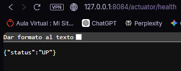

### Parte C — Dockerfile multi-stage

Se escribió un `Dockerfile` de dos etapas. La primera compila con Maven sobre `maven:3.9-eclipse-temurin-21`; la segunda parte de `eclipse-temurin:21-jre` y se limita a copiar el JAR resultante.

**Por qué multi-stage.** Compilar necesita Maven y el JDK completo, pero ejecutar solo necesita el JAR y un JRE. Todo lo que no está en la imagen final —el compilador, Maven, el repositorio local de dependencias, el código fuente— es a la vez peso que no se transfiere y superficie de ataque que no existe.

**Seguridad.** La imagen crea un usuario de sistema sin privilegios y cambia a él con `USER app` antes del `ENTRYPOINT`. Si alguien consigue ejecución dentro del contenedor, no lo hace como `root`.

**El `.dockerignore`.** Cumple dos funciones: evitar enviar al demonio de Docker ficheros innecesarios (`target/`, `.git/`), lo que acelera el build, e impedir que ficheros sensibles como `.env` acaben copiados dentro de una imagen que luego se publica en un registro.

Se construyó la imagen y se arrancó un contenedor, comprobando con `docker ps` que la columna `STATUS` pasaba a `(healthy)` pasados los segundos del `start-period`:

```bash
docker build -t tareas-api:0.1 .
docker run --rm -p 8080:8080 tareas-api:0.1
docker ps
```

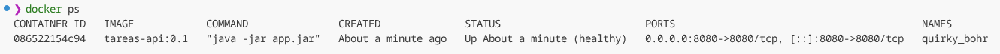

**Comparación de tamaños.** Se construyó también solo la etapa intermedia para poder comparar:

```bash
docker build --target build -t tareas-api:build .
docker images tareas-api
```

| Imagen | Tamaño |
|---|---|
| `tareas-api:build` (etapa de compilación) | 736 MB |
| `tareas-api:0.1` (imagen final) | 378 MB |

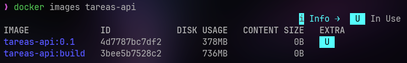

La diferencia procede de que la etapa `build` arrastra el JDK completo, el propio Maven y el repositorio local `~/.m2` con todas las dependencias descargadas, además del código fuente. La imagen final solo contiene un JRE, `curl` y el fat JAR.

**Demostración de la caché de capas.** Se hizo el experimento en dos pasos, usando la constante `TEST_DOCKER` de `TaskController` como línea a modificar:

| Escenario | Tiempo |
|---|---|
| Orden correcto (`COPY pom.xml` antes de `COPY src`), cambiando una clase | 8.3 s (caché activa en las capas de dependencias) |
| Orden invertido (`COPY src` por encima de `COPY pom.xml`), cambiando una clase | 1m 56s |

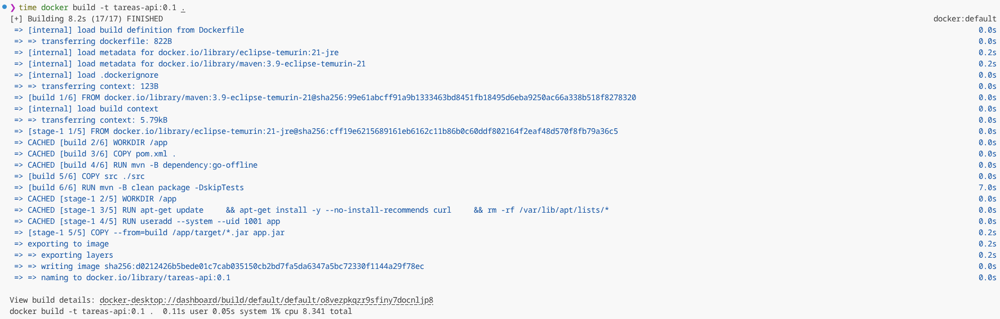

Con el orden correcto, cambiar una clase Java solo invalida la capa `COPY src ./src` y las siguientes: la capa de `dependency:go-offline` se reutiliza intacta. Con el orden invertido, el `COPY src` queda por encima, así que cualquier cambio en el código invalida también la descarga de dependencias y Docker vuelve a bajar medio Maven Central en cada build. El `Dockerfile` se dejó en su orden original.

- **Commit 2:** `feat(docker): añadir Dockerfile` ([3eb014d](https://github.com/hsanchezm7/tasky/commit/3eb014d)).
- **Commit 4:** `fix(fix):arreglo en Dockerfile` ([15fb2a6](https://github.com/hsanchezm7/tasky/commit/15fb2a6)).

### Parte D — De H2 a PostgreSQL con Compose

Hasta este boletín la aplicación usaba H2 en memoria, lo que significa que los datos desaparecían al parar el proceso. Se sustituyó por PostgreSQL en un segundo contenedor, con persistencia real.

En el `pom.xml` se retiró H2 y se añadió el driver de PostgreSQL, manteniendo Spring Data JPA con Hibernate. En `application.properties` se eliminaron todas las propiedades de H2 y se dejó la conexión parametrizada, con `spring.jpa.hibernate.ddl-auto=update` para que Hibernate mantenga el esquema.

El `docker-compose.yml` define los dos servicios. Merece la pena detenerse en tres decisiones:

- **El puerto de `db` se publica solo en el loopback** (`127.0.0.1:5432:5432`). Permite conectar un cliente SQL desde la máquina, pero no expone PostgreSQL a la red local. Para que la API hable con la base de datos no haría falta publicar nada: dentro de la red de Compose cada servicio es alcanzable por su nombre.

- **El volumen nombrado `db-data`** es lo que da persistencia: los datos viven fuera del ciclo de vida del contenedor.

- **`depends_on` con `condition: service_healthy`** no espera a que el contenedor de PostgreSQL *exista*, sino a que su `healthcheck` (`pg_isready`) confirme que **acepta conexiones**. Sin esa condición, la API arrancaría antes de tiempo y fallaría al conectar.

**Comprobación de la persistencia.** Se levantó el stack, se insertó una tarea y se verificó su supervivencia a un ciclo de parada y arranque:

```bash
docker compose up --build -d
docker compose ps            # ambos servicios (healthy)
```

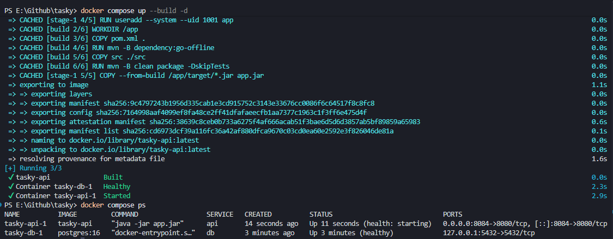

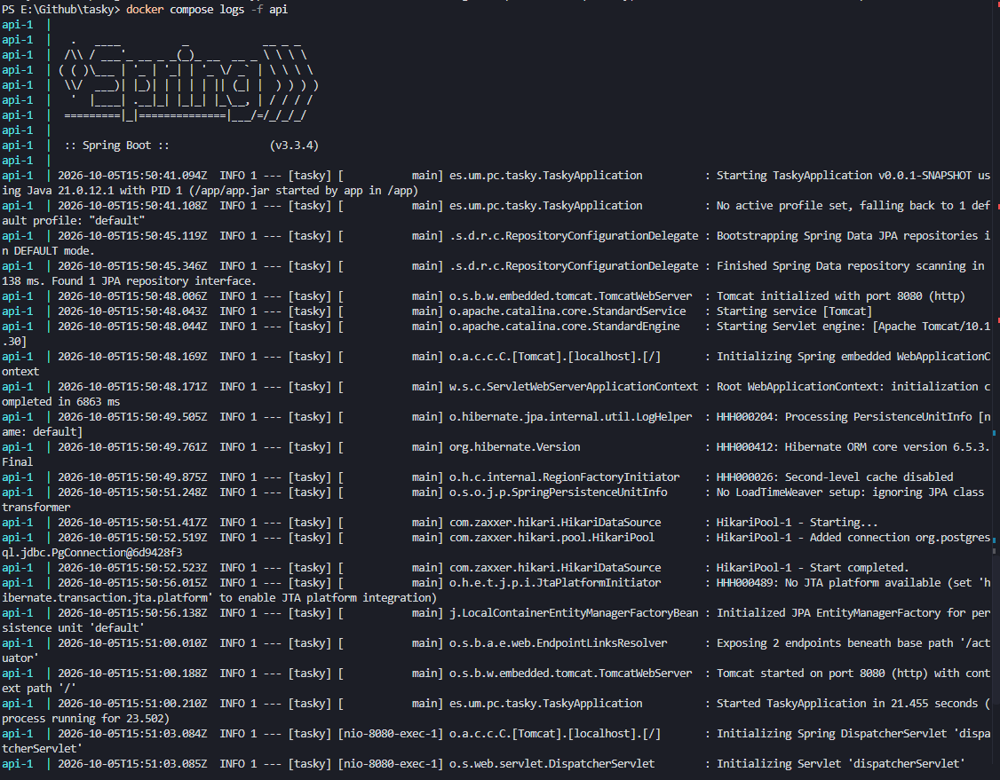

```bash
curl -X POST http://localhost:8084/api/tasks \
  -H "Content-Type: application/json" \
  -d '{"title": "Comprobar persistencia"}'
```

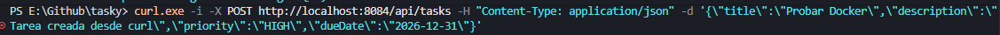

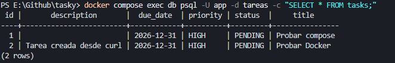

```bash
docker compose down
docker compose up -d
curl http://localhost:8084/api/tasks    # el dato sigue ahí

docker compose down -v
docker compose up -d
curl http://localhost:8084/api/tasks    # lista vacía
```

**`docker compose down` frente a `docker compose down -v`.** La diferencia principal es que la opción `-v` **borra los volúmenes**, y el volumen `tasky_db-data` es justamente donde PostgreSQL guarda los datos. Al hacer después `docker compose up`, Docker crea un volumen nuevo y vacío, por lo que la base de datos se inicializa desde cero y la lista de tareas aparece vacía.

| Comando | Qué borra | Qué conserva |
|---|---|---|
| `down` | Contenedores y la red de Compose. | **El volumen `tasky_db-data`**, y con él los datos de PostgreSQL. Al volver a levantar, las tareas siguen ahí. |
| `down -v` | Contenedores, red **y el volumen `tasky_db-data`**. | Nada: Docker crea un volumen nuevo y vacío en el siguiente `up`, y la base de datos vuelve a inicializarse. |

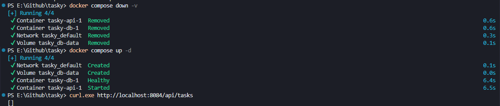

En el `docker-compose.yml` el volumen se declara como `db-data`; Compose le antepone el nombre del proyecto (el de la carpeta), de ahí que aparezca como `tasky_db-data` al listarlo con `docker volume ls`.

Esta distinción no es anecdótica: `down -v` es la forma habitual de partir de cero en desarrollo, y es justamente lo que hay que hacer cuando se cambian las credenciales en el `.env`, porque PostgreSQL solo usa `POSTGRES_USER`, `POSTGRES_PASSWORD` y `POSTGRES_DB` **la primera vez que inicializa el volumen**.

- **Commit 3:** `build(compose): cambio de h2 a Post con docker` ([19b9a89](https://github.com/hsanchezm7/tasky/commit/19b9a89)).

### Parte E — Sacar la configuración a un fichero `.env`

Tal y como quedó en la parte anterior, el `docker-compose.yml` llevaba la contraseña escrita en texto plano y estaba camino del repositorio. Se trasladó la configuración a variables.

Se creó `.env.example`, que **sí se versiona** y documenta qué variables necesita el proyecto (`API_PORT`, `POSTGRES_DB`, `POSTGRES_USER`, `POSTGRES_PASSWORD`). Cada integrante genera su propio `.env` con `cp .env.example .env`. Ese `.env` no llega a ningún sitio: está en el `.gitignore` desde el Boletín 1 y en el `.dockerignore` desde la Parte C, de modo que ni se versiona ni entra en el contexto de build de la imagen.

Después se sustituyeron en el YAML los valores escritos a mano por referencias a variables. El boletín presenta varias formas de trabajar con ellas:

| Forma | Qué hace | Dónde se usa en nuestro Compose |
|---|---|---|
| `${VAR}` | Compose sustituye la variable por su valor antes de crear el contenedor, tomándola del entorno o del `.env`. | — |
| `${VAR:-valor}` | Igual, pero con un valor por defecto si la variable no está definida. | `POSTGRES_DB`, `POSTGRES_USER`, `API_PORT` y `SPRING_DATASOURCE_URL/USERNAME`. |
| `${VAR:?mensaje}` | Obliga a que la variable exista y no esté vacía; si no, Compose aborta con ese mensaje. | `POSTGRES_PASSWORD` (en `db` y en `api`): si falta, Compose no arranca y muestra `Falta POSTGRES_PASSWORD; crea el .env con cp .env.example .env`. |
| `$${VAR}` | El `$$` escapa el símbolo, de modo que Compose **no** sustituye y la expresión llega literal al contenedor para resolverse allí dentro. | `healthcheck` del servicio `db`: `pg_isready -U $${POSTGRES_USER} -d $${POSTGRES_DB}`, que el shell del contenedor expande con las variables ya presentes en su entorno. |

Antes de levantar nada se verificó la sustitución pidiendo a Compose la configuración ya resuelta:

```bash
docker compose config
```

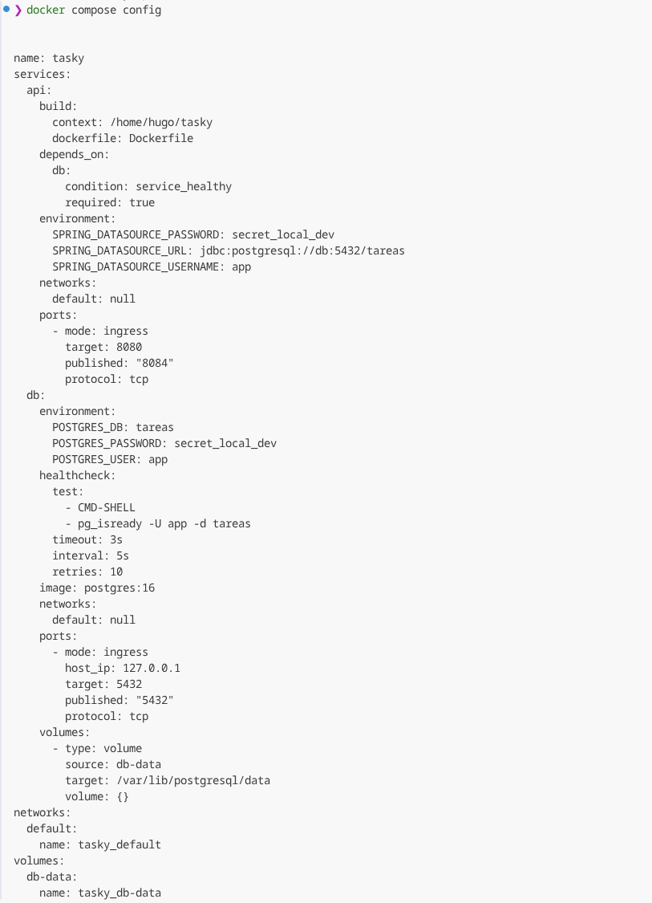

En la salida aparecen `tareas`, `app` y la contraseña en lugar de las expresiones `${...}`.

Por último se levantó el stack partiendo de cero y se comprobó la salud de la API:

```bash
docker compose down -v
docker compose up --build -d
docker compose ps
curl http://localhost:8084/actuator/health
```

- **Commit 5:** `chore(env): crear .env de ejemplo` ([e14ccb8](https://github.com/hsanchezm7/tasky/commit/e14ccb8)).

### Parte F — Dev container

Un dev container define el entorno de desarrollo **como código**: quien clone el repositorio obtiene el mismo JDK, el mismo Maven y las mismas herramientas sin instalar nada en su máquina. Sigue la *Dev Containers spec*, un estándar abierto soportado por VS Code, GitHub Codespaces y la CLI `devcontainer`.

Significado de cada campo del `devcontainer.json`:

| Campo | Qué indica |
|---|---|
| `name` | Nombre con el que se identifica el entorno en VS Code. |
| `image` | Imagen base del contenedor de desarrollo: `mcr.microsoft.com/devcontainers/java:21`, que ya trae el JDK 21 y las herramientas habituales. |
| `features` | Capas adicionales reutilizables que se instalan sobre la imagen base, sin tener que escribir un Dockerfile propio. |
| `forwardPorts` | Puertos del contenedor que se publican en la máquina anfitriona: el 8080 de la API y el 5432 de PostgreSQL. |
| `postCreateCommand` | Órdenes que se ejecutan una sola vez, al crear el contenedor. |
| `customizations.vscode.extensions` | Extensiones que VS Code instala automáticamente dentro del contenedor: el pack de Java y la de Docker. |

#### ¿Para qué sirve la feature `docker-in-docker`?

La feature `docker-in-docker` sirve para tener un Docker completo dentro del dev container. En nuestro proyecto se declara en el fichero `.devcontainer/devcontainer.json`.

La necesitamos porque, cuando abrimos el proyecto en un dev container, la terminal está dentro de un contenedor basado en la imagen `mcr.microsoft.com/devcontainers/java:21`. Esa imagen trae Java y, con otra feature, Maven, pero **no trae Docker**. Sin `docker-in-docker`, comandos como `docker`, `docker compose up` o `docker build` fallarían, porque el comando `docker` sencillamente no existe dentro del contenedor.

Esta feature instala dentro del contenedor:

- el **daemon de Docker** (`dockerd`), que arranca dentro del propio dev container;
- el **CLI de Docker** y el plugin `docker compose`.

Así se puede hacer dentro del dev container exactamente lo mismo que hemos hecho en la máquina local a lo largo de este boletín: levantar `db` y `api` con Compose, construir la imagen con el `Dockerfile`, etc. También les sirve a herramientas como **Testcontainers**, si algún día las usamos en los tests.

La opción `"moby": false` indica que se instale Docker CE en lugar de Moby, su variante de código abierto.

#### ¿Qué hace cada una de las tres órdenes de `postCreateCommand`?

El `postCreateCommand` se ejecuta **una sola vez**, al crear el dev container, y lanza tres órdenes independientes. Van separadas por `;`, de modo que un fallo en una **no detiene** las siguientes (a diferencia de `&&`).

1. **Crear `.env` desde la plantilla.** `test -f .env || cp .env.example .env`: si no existe un `.env`, lo copia de `.env.example`. Como el `.env` está en el `.gitignore`, quien clone el repositorio no tiene ninguno, y esta orden se lo genera. Depende por completo de que exista `.env.example` en el repositorio: si no estuviera, la orden fallaría en cada creación del contenedor y el entorno quedaría sin configuración.

2. **Activar los hooks compartidos.** `if [ -d .githooks ]; then git config core.hooksPath .githooks; fi`: si existe la carpeta `.githooks/`, le dice a Git que use esa carpeta para los hooks. Así se activa el `pre-commit` del Boletín 1, que formatea el código con Spotless (y cancela el commit si falla) y después hace `git add -u`. Es necesario porque `core.hooksPath` es **configuración local** y no viaja con el repositorio. Conviene tener presente un efecto secundario: ese `git add -u` añade al commit **todos** los ficheros versionados con cambios, no solo los que Spotless ha reformateado.

3. **Precargar las dependencias de Maven.** `mvn -B dependency:go-offline` descarga por adelantado a `~/.m2` todo lo que declara el `pom.xml`, para que el primer `spring-boot:run` o el primer `mvn test` dentro del contenedor sean rápidos en lugar de quedarse descargando medio Maven Central.

En VS Code se usó *Dev Containers: Reopen in Container* y, ya dentro, se ejecutó `docker compose up --build`:

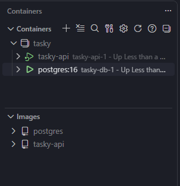

La API respondía desde el navegador de la máquina anfitriona:


- **Commit 6:** `build(devcontainer): añadir entorno de desarrollo en contenedor` ([54ae67b](https://github.com/hsanchezm7/tasky/commit/54ae67b)).

### Parte G — Versionar los cambios

Todos los cambios del boletín se desarrollaron en una rama de feature y se integraron en `main` mediante el **[PR #9](https://github.com/hsanchezm7/tasky/pull/9)**, siguiendo el mismo flujo del Boletín 2: la rama protegida impide el push directo, el PR cargó la plantilla, los *code owners* fueron solicitados automáticamente como revisores y la fusión se hizo tras la aprobación.

El PR agrupa 13 ficheros y 185 líneas añadidas: `Dockerfile`, `.dockerignore`, `docker-compose.yml`, `.env.example`, `.devcontainer/devcontainer.json` y su *lock*, más los cambios en `pom.xml`, `application.properties`, el `README.md` y el código afectado por la corrección del enum.

- **Commit 7:** fusión del PR #9 ([25fcef5](https://github.com/hsanchezm7/tasky/commit/25fcef5)).

### Parte H — Registry de Docker

Se creó una cuenta en Docker Hub y un repositorio público `hsanchezm7/tasky`. Los pasos seguidos desde la terminal:

```bash
# 1. Autenticarse
docker login

# 2. Etiquetar la imagen local con el nombre del repositorio remoto
docker tag tareas-api:0.1 hsanchezm7/tasky:0.1

# 3. Publicar
docker push hsanchezm7/tasky:0.1

# 4. Verificar que puede descargarse desde una máquina limpia
docker pull hsanchezm7/tasky:0.1
```

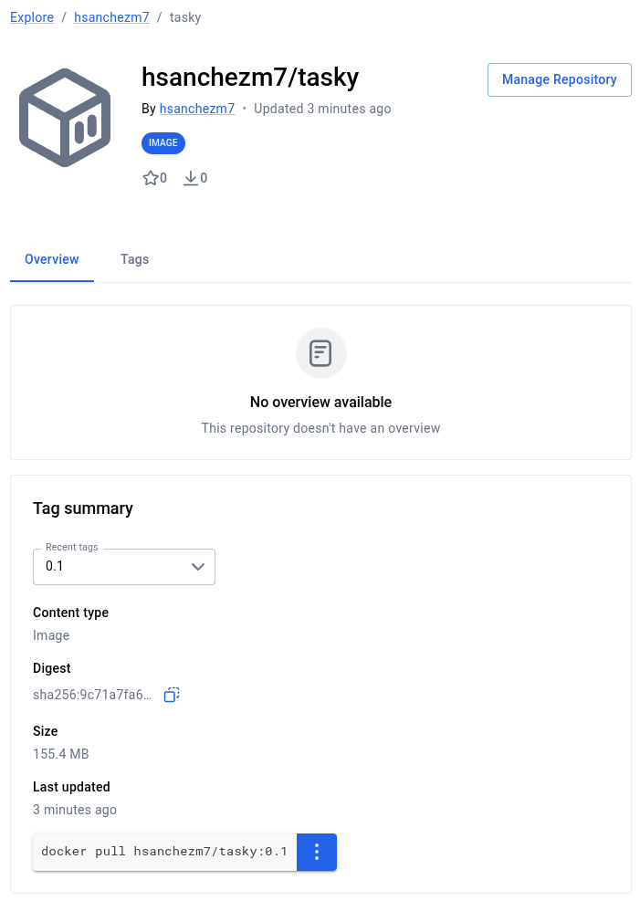

### Parte I — Entorno de pruebas reproducible

Esta parte tampoco modifica el repositorio del proyecto: se documenta aquí.

#### 1. Repositorio elegido

**[psf/requests](https://github.com/psf/requests)** — *A simple, yet elegant, HTTP library*, la librería HTTP de referencia en Python. Cumple de sobra el criterio de "popular y de uso real": ronda las **53.000 estrellas** en GitHub y es una de las dependencias más descargadas de PyPI. Además tiene una batería de tests amplia y un `Makefile` que documenta cómo ejecutarla, lo que la hace un buen caso para contenerizar.

#### 2. Análisis de requisitos

Todos los datos se han obtenido de ficheros del propio repositorio, no de suposiciones:

| Requisito | Valor | Fuente |
|---|---|---|
| Lenguaje y versión | Python **≥ 3.10** | `pyproject.toml`, campo `requires-python` |
| Gestor de paquetes | **pip** | `requirements-dev.txt` |
| Dependencias de ejecución | `charset_normalizer>=2,<4`, `idna>=2.5,<4`, `urllib3>=1.26,<3`, `certifi>=2023.5.7` | `pyproject.toml`, bloque `dependencies` |
| Dependencias de desarrollo y test | `-e .[socks]`, `pytest>=2.8.0,<10`, `pytest-cov`, `pytest-httpbin==2.1.0`, `httpbin~=0.10.0`, `trustme`, `wheel` | `requirements-dev.txt` |
| Instalación de dependencias | `make init` → `python -m pip install -r requirements-dev.txt` | `Makefile`, objetivo `init` |
| Ejecución de los tests | `make test` → `python -m pytest tests` | `Makefile`, objetivo `test` |
| Entorno de la CI oficial | Matriz de Python 3.10 a 3.15 (más PyPy) sobre Ubuntu, macOS y Windows | `.github/workflows/run-tests.yml` |

Dos detalles condicionan el diseño del Dockerfile:

- `requirements-dev.txt` empieza por **`-e .[socks]`**, es decir, instala el propio proyecto en modo editable. Eso obliga a que el directorio `src/` esté presente **antes** de ejecutar el `pip install`, porque si no la instalación falla.
- Las dependencias de test incluyen **`pytest-httpbin`** y **`httpbin`**, que levantan un servidor HTTP local durante la ejecución. Gracias a ello la mayor parte de la batería no necesita salir a internet, lo que hace el contenedor mucho más reproducible.

También se añaden dos paquetes del sistema: `git`, que algunas herramientas del proyecto esperan encontrar, y `build-essential`, necesario por si alguna dependencia no distribuye rueda precompilada para la plataforma y hay que compilarla.

#### 3. Dockerfile

```dockerfile
FROM python:3.12-slim

# Dependencias del sistema
RUN apt-get update \
    && apt-get install -y --no-install-recommends git build-essential \
    && rm -rf /var/lib/apt/lists/*

WORKDIR /app

ENV PYTHONDONTWRITEBYTECODE=1 \
    PYTHONUNBUFFERED=1

# Primero solo los ficheros que declaran dependencias: así, mientras no cambien,
# Docker reutiliza la capa de instalación aunque cambie el código fuente.
COPY pyproject.toml setup.py requirements-dev.txt README.md ./
COPY src ./src

# requirements-dev.txt incluye "-e .[socks]", que instala el propio proyecto
# en modo editable; por eso src/ tiene que estar presente en este paso.
RUN python -m pip install --no-cache-dir --upgrade pip \
    && python -m pip install --no-cache-dir -r requirements-dev.txt

# Resto del repositorio (tests, configuración de pytest, etc.)
COPY . .

# Misma orden que el objetivo "test" del Makefile del proyecto
CMD ["python", "-m", "pytest", "tests", "-q"]
```

Decisiones tomadas y su motivo:

- **Imagen base `python:3.12-slim`.** Una versión dentro del rango soportado por el proyecto y presente en su matriz de CI, en la variante *slim* para que la imagen no arrastre paquetes innecesarios.
- **Orden de los `COPY`.** Es la misma estrategia de caché aplicada en la Parte C a nuestro propio Dockerfile: lo que cambia poco (los ficheros de dependencias) arriba, lo que cambia mucho (el código y los tests) abajo. Así, editar un test no obliga a reinstalar todas las dependencias de pip.
- **`PYTHONDONTWRITEBYTECODE` y `PYTHONUNBUFFERED`.** La primera evita que se generen ficheros `.pyc` dentro del volumen montado; la segunda hace que la salida de pytest aparezca en vivo en lugar de quedarse en el buffer.
- **`CMD` en lugar de `ENTRYPOINT`.** Permite sobrescribir el comando al lanzar el contenedor para, por ejemplo, ejecutar solo un subconjunto de tests.

#### 4. Construcción y ejecución

```bash
git clone https://github.com/psf/requests
cd requests
# (se copia el Dockerfile a la raíz del clon)

docker build -f Dockerfile.requests-tests -t requests-tests .
docker run --rm -v "$(pwd)":/app requests-tests
```

El montaje `-v "$(pwd)":/app` es lo que pide el enunciado: **la imagen aporta el entorno y el código fuente viene del disco del anfitrión**. De este modo se puede editar un test en el editor local y relanzar la batería sin reconstruir la imagen.

Resultado obtenido:

```
619 passed, 15 skipped, 1 xfailed, 18 warnings in 78.85s (0:01:18)
```

| Resultado | Nº de tests |
|---|---|
| Pasados | 619 |
| Omitidos (`skipped`) | 15 |
| Fallo esperado (`xfailed`) | 1 |
| Fallidos | 0 |

> **Nota sobre los tests omitidos.** Los 15 tests marcados como `skipped` corresponden principalmente a tests de la clase `TestTimeout` que intentan conectar a una dirección IP deliberadamente inalcanzable para verificar que se dispara el timeout de conexión. En una red con proxy o con filtrado de salida no se comportan como el test espera. Se han excluido automáticamente por el entorno de ejecución, aunque la librería funciona correctamente. El `xfailed` es un test marcado como fallo esperado por el propio proyecto y no indica ningún problema.


## Uso de IA en la sesión

| Herramienta | Para qué se usó | Commits afectados |
|---|---|---|
| Claude | **Cambios en código:** generación y ajuste del `Dockerfile` multi-stage y el `.dockerignore`, migración de H2 a PostgreSQL (`pom.xml` y `application.properties`), redacción del `docker-compose.yml`, la plantilla `.env.example` y el `devcontainer.json`. | 1, 2, 3, 5, 6 |
| Claude | **Desarrollo del boletín:** redacción de esta memoria a partir del historial real del repositorio, elaboración de las tablas de commits y de las explicaciones de las partes C, D, E, F e I. | — (no genera commits) |

En todos los casos se ha revisado y entendido lo generado antes de incorporarlo, y se ha ajustado a las convenciones del repositorio.

Todos los commits están firmados con el nombre del estudiante que los ha realizado. Ningún commit ha sido hecho por la IA.
