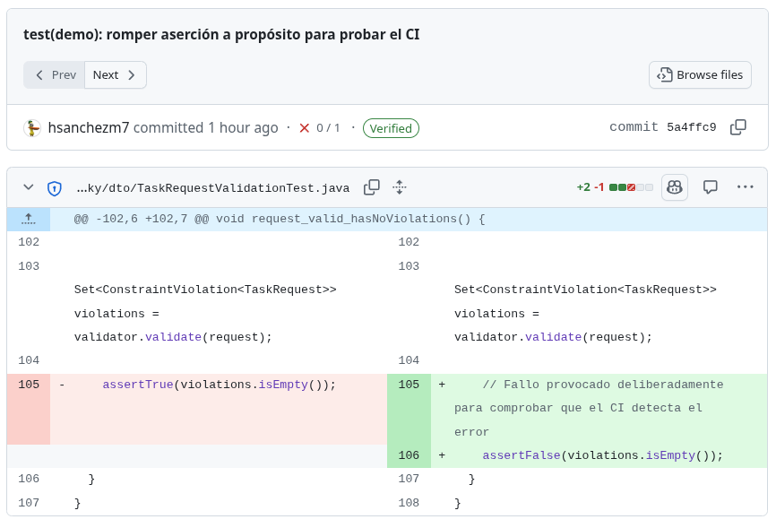
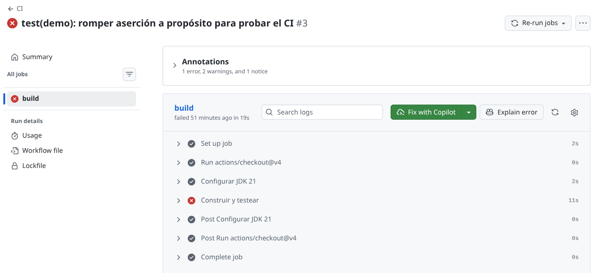
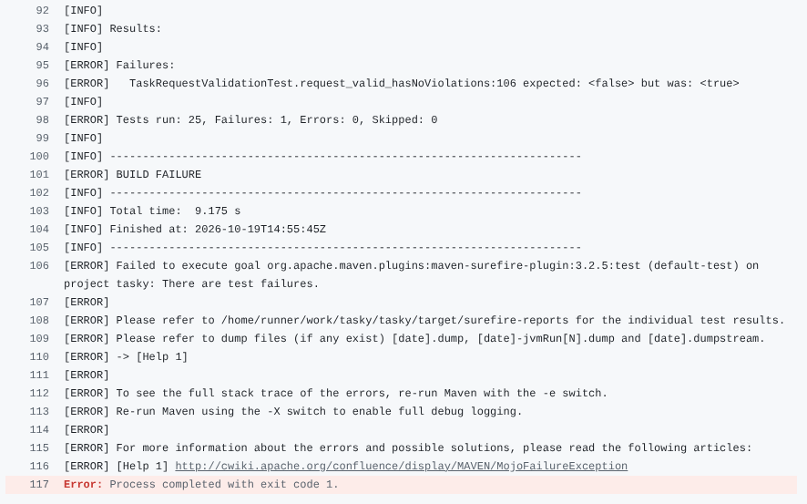
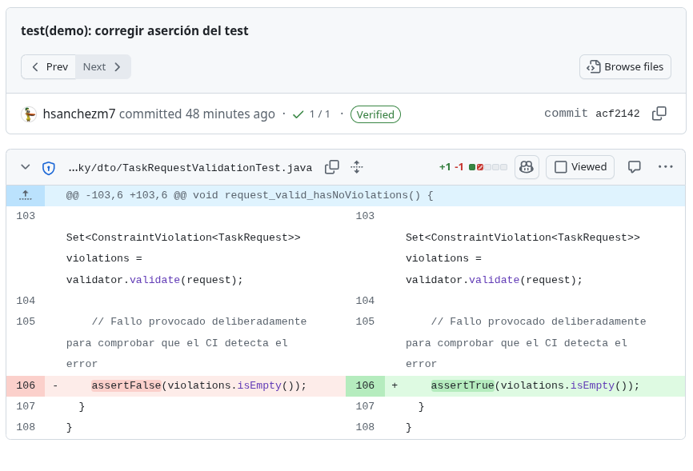
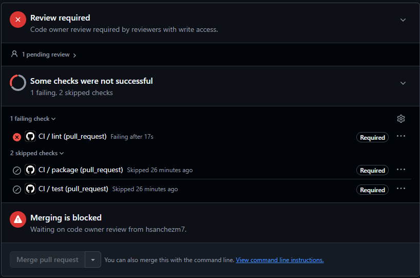
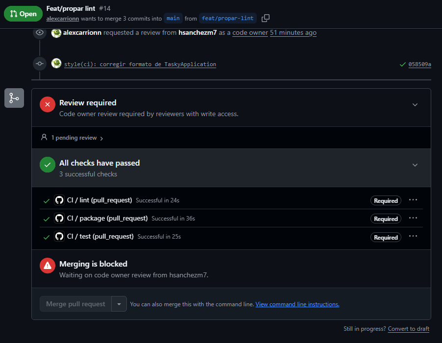
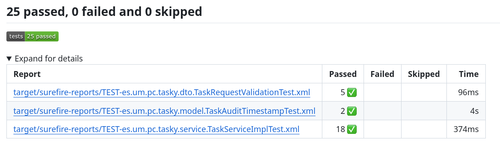
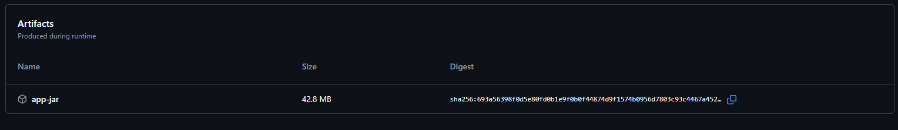
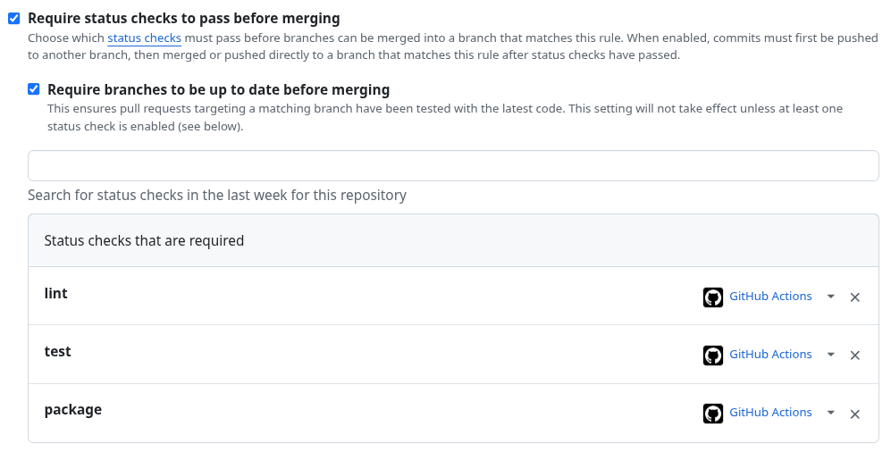
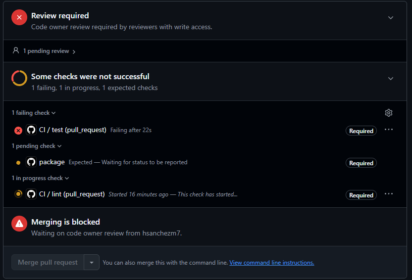

# Boletín 4

**Repositorio:** [hsanchezm7/tasky](https://github.com/hsanchezm7/tasky)
**Autores:** Hugo Sánchez (`hsanchezm7`) y Alejandro Carrión Jordán (`alexcarrionn`)
**Pull Requests de la sesión:** [#11 — feat(ci): add ci workflow](https://github.com/hsanchezm7/tasky/pull/11) y [#13 — refactor(ci): separar el pipeline en jobs](https://github.com/hsanchezm7/tasky/pull/13)

## Resumen de commits

| # | Mensaje del commit | Rama | Qué se hizo | Autor | Enlace |
|---|--------------------|------|-------------|-------|--------|
| 1 | `feat(ci): add ci workflow` | `feat/ci-pipeline` | Primer pipeline: `.github/workflows/ci.yml` con un único job `build` (checkout, JDK 21 con caché de Maven y `mvn --batch-mode verify`). Añade además H2 con `scope: test` al `pom.xml`, necesaria para que los tests `@DataJpaTest` arranquen en el runner. | Hugo Sánchez | [b0e0600](https://github.com/hsanchezm7/tasky/commit/b0e0600) |
| 2 | `feat(ci): add ci workflow (#11)` | `main` | Commit de fusión del **[PR #11](https://github.com/hsanchezm7/tasky/pull/11)**. | Hugo Sánchez | [61600af](https://github.com/hsanchezm7/tasky/commit/61600afe75592ab2846865a0bfb175cc32a00c8e) |
| 3 | `test(demo): romper aserción a propósito para probar el CI` | `test/demo-failing-ci` | Cambia `assertTrue(violations.isEmpty())` por `assertFalse(...)` en `TaskRequestValidationTest` para que el pipeline se ponga en rojo. | Hugo Sánchez | [5a4ffc9](https://github.com/hsanchezm7/tasky/commit/5a4ffc9) |
| 4 | `test(demo): corregir aserción del test` | `test/demo-failing-ci` | Revierte la aserción al valor correcto; el check vuelve a verde sobre el mismo PR. | Hugo Sánchez | [acf2142](https://github.com/hsanchezm7/tasky/commit/acf2142) |
| 5 | `refactor(ci):separar el pipeline en jobs lint, test y package` | `feat/ci-jobs` | Reestructura `ci.yml` en tres jobs encadenados con `needs` (`lint` → `test` → `package`), amplía `permissions`, publica el informe JUnit con `dorny/test-reporter` y sube el JAR como artefacto. | Alejandro Carrión | [a10d56b](https://github.com/hsanchezm7/tasky/commit/a10d56b) |
| 6 | `refactor(ci):separar el pipeline en jobs lint, test y package (#13)` | `main` | Commit de fusión del **[PR #13](https://github.com/hsanchezm7/tasky/pull/13)**. | Alejandro Carrión | [7978dfc](https://github.com/hsanchezm7/tasky/commit/7978dfc027a74367ada6f7850936e7552356abf2) |
| 7 | `Update setting lint` | `feat/propar-lint` | Desactiva `editor.formatOnSave` en `.vscode/settings.json` y quita una línea en blanco de `TaskyApplication`, como preparación para poder romper el formato sin que el editor lo arregle solo. | Alejandro Carrión | [d28b7ac](https://github.com/hsanchezm7/tasky/commit/d28b7ac) |
| 8 | `test(ci): romper formato` | `feat/propar-lint` | Desordena la indentación del `main` de `TaskyApplication` y elimina el espacio tras una coma. Commiteado con `--no-verify` para saltar el hook de Spotless. | Alejandro Carrión | [a7aa870](https://github.com/hsanchezm7/tasky/commit/a7aa870) |
| 9 | `test: romper test a propósito` | `test/romper-test` | Cambia la aserción de `TaskServiceImplTest` (`PENDING` → `COMPLETED`) para comprobar que la protección de rama impide fusionar con el CI en rojo. | Alejandro Carrión | [7ed9b8a](https://github.com/hsanchezm7/tasky/commit/7ed9b8a) |
| 10 | `style(ci): corregir formato de TaskyApplication` | `feat/propar-lint` | Devuelve `TaskyApplication` al formato correcto con `mvn spotless:apply`; el pipeline recorre los tres jobs en verde, publica el informe JUnit y genera el artefacto `app-jar`. | Alejandro Carrión | [058509a](https://github.com/hsanchezm7/tasky/commit/058509a) |

> Los commits 3, 4 y 7–10 pertenecen a ramas de demostración que **no se fusionan en `main`**: su finalidad es probar que el pipeline y la protección de rama funcionan. Se dejan publicadas en el repositorio como evidencia.

## Detalle por commit

### 1. `feat(ci): add ci workflow`

- **Rama:** `feat/ci-pipeline`

- **Qué se hizo:**

  - Creación de `.github/workflows/ci.yml`, el primer pipeline de Integración Continua del proyecto, con un único job `build` que hace checkout, configura el JDK 21 de Temurin con caché de Maven y ejecuta `mvn --batch-mode verify`.

  - Configuración de los disparadores (`push` a `main` y cualquier `pull_request`), del bloque `concurrency` y de `permissions: contents: read`, el permiso mínimo que necesita el workflow.

  - Adición al `pom.xml` de la dependencia **H2 con `<scope>test</scope>`**. Hizo falta porque el test `TaskAuditTimestampTest`, incorporado al repositorio en el [PR #8](https://github.com/hsanchezm7/tasky/pull/8), está anotado con `@DataJpaTest` y necesita una base de datos embebida: en local podía apoyarse en el PostgreSQL de Compose, pero el runner de GitHub no tiene ninguna base de datos levantada y `mvn verify` fallaba.

- **Autor:** Hugo Sánchez (`hugosanchezmartinez4@gmail.com`)

- **Relación con el boletín:** Apartado **Parte A** (Primer pipeline de CI).

### 2. `feat(ci): add ci workflow (#11)`

- **Rama:** fusión en `main`

- **Qué se hizo:** fusión del **[PR #11](https://github.com/hsanchezm7/tasky/pull/11)** tras la revisión y aprobación. A partir de este commit, todo PR abierto contra el repositorio ejecuta el pipeline.

- **Autor:** Hugo Sánchez (fusión desde la interfaz web de GitHub)

- **Relación con el boletín:** Parte A.

- **Uso de IA:** No se ha usado.

### 3. `test(demo): romper aserción a propósito para probar el CI`

- **Rama:** `test/demo-failing-ci`, creada a partir de `61600af`

- **Qué se hizo:** en `TaskRequestValidationTest` se sustituyó `assertTrue(violations.isEmpty())` por `assertFalse(violations.isEmpty())`, con un comentario que deja constancia de que el fallo es deliberado. El test comprueba que una petición válida no genera violaciones de Bean Validation, así que invertir la aserción lo hace fallar de forma limpia, sin romper la compilación.

- **Autor:** Hugo Sánchez (`hugosanchezmartinez4@gmail.com`)

- **Relación con el boletín:** Apartado **Parte B** (Demostrar que el CI atrapa errores), primer paso.

- **Uso de IA:** No se ha usado.

### 4. `test(demo): corregir aserción del test`

- **Rama:** `test/demo-failing-ci`

- **Qué se hizo:** se devolvió la aserción a `assertTrue(violations.isEmpty())` y se hizo push **a la misma rama**, sin cerrar ni reabrir el PR. GitHub relanzó el pipeline automáticamente y el check pasó de rojo a verde.

- **Autor:** Hugo Sánchez (`hugosanchezmartinez4@gmail.com`)

- **Relación con el boletín:** Parte B, segundo paso.

- **Uso de IA:** No se ha usado.

### 5. `refactor(ci):separar el pipeline en jobs lint, test y package`

- **Rama:** `feat/ci-jobs`

- **Qué se hizo:**

  - Reestructuración de `ci.yml`, que pasa de un único job `build` a **tres jobs encadenados con `needs`**:

    - **`lint`** — ejecuta `mvn -B spotless:check`, la misma comprobación de formato que el hook de pre-commit del Boletín 1, ahora como barrera del pipeline.
    - **`test`** — depende de `lint`; ejecuta `mvn -B verify` y publica el informe JUnit con `dorny/test-reporter@v3` a partir de `target/surefire-reports/*.xml`, con `if: always()`.
    - **`package`** — depende de `test`; ejecuta `mvn -B package -DskipTests` y sube el JAR resultante como artefacto `app-jar` con 7 días de retención.

  - Ampliación del bloque `permissions`, que pasa de solo `contents: read` a incluir `actions: read` y `checks: write`, los permisos que `dorny/test-reporter` necesita para consultar el run y publicar el informe como check del PR.

- **Autor:** Alejandro Carrión Jordán (`acarrionjordan@gmail.com`)

- **Relación con el boletín:** Apartado **Parte C** (Separar responsabilidades en jobs).

- **Uso de IA:** Claude, para escribir el `ci.yml` con los tres jobs a partir del enunciado.

- **Nota sobre el mensaje:** falta el espacio tras los dos puntos (`refactor(ci):separar`), igual que ocurrió en el Boletín 3. Conventional Commits exige `tipo(ámbito): descripción`.

### 6. `refactor(ci):separar el pipeline en jobs lint, test y package (#13)`

- **Rama:** fusión en `main`

- **Qué se hizo:** fusión del **[PR #13](https://github.com/hsanchezm7/tasky/pull/13)**. Desde este commit, los tres checks que aparecen en los PR son `lint`, `test` y `package`, que son los que después se seleccionan como *required status checks* en la Parte D.

- **Autor:** Alejandro Carrión Jordán (fusión desde la interfaz web de GitHub)

- **Relación con el boletín:** Parte C.

- **Uso de IA:** No se ha usado.

### 7. `Update setting lint`

- **Rama:** `feat/propar-lint`, creada a partir de `7978dfc`

- **Qué se hizo:** se añadió `.vscode/settings.json` con `"editor.formatOnSave": false` y se eliminó una línea en blanco de `TaskyApplication.java`. Es un paso preparatorio: con el formateo al guardar activado, VS Code deshacía el desorden de indentación antes de poder commitearlo, así que había que desactivarlo para provocar el fallo de formato del paso siguiente.

- **Autor:** Alejandro Carrión Jordán (`acarrionjordan@gmail.com`)

- **Relación con el boletín:** Apartado **Parte C**, preparación de la demostración del fallo de `lint`.

- **Uso de IA:** Claude. Detectó que `editor.formatOnSave` deshacía el desorden al guardar y creó `.vscode/settings.json` para desactivarlo solo en este proyecto. El commit lo hizo el estudiante.

- **Nota sobre el mensaje:** `Update setting lint` no sigue Conventional Commits. Lo correspondiente habría sido `chore(editor): desactiva formatOnSave en VS Code`.

### 8. `test(ci): romper formato`

- **Rama:** `feat/propar-lint`

- **Qué se hizo:** se desordenó a propósito el método `main` de `TaskyApplication.java`, metiendo espacios de más en la declaración y quitando el espacio tras la coma de la llamada a `SpringApplication.run`:

  ```java
          public    static void main(String[] args) {
      SpringApplication.run(TaskyApplication.class,args);
  ```

  El commit se hizo con **`git commit --no-verify`** para saltar el hook de pre-commit, que de lo contrario habría ejecutado `spotless:apply` y habría arreglado el formato antes de confirmar el commit. Esto es justamente lo que demuestra por qué el hook local no basta y hace falta la comprobación en CI.

- **Autor:** Alejandro Carrión Jordán (`acarrionjordan@gmail.com`)

- **Relación con el boletín:** Parte C, demostración de que `lint` falla y los jobs `test` y `package` ni siquiera llegan a ejecutarse.

- **Uso de IA:** Claude. Escribió la versión desordenada de `TaskyApplication.java` y comprobó en local con `mvn spotless:check` que Spotless la detectaba. El commit con `--no-verify` y el push los hizo el estudiante.

### 9. `test: romper test a propósito`

- **Rama:** `test/romper-test`, creada a partir de `7978dfc`

- **Qué se hizo:** en `TaskServiceImplTest` se cambió `assertEquals(TaskStatus.PENDING, created.getStatus())` por `assertEquals(TaskStatus.COMPLETED, ...)`. El test comprueba que una tarea recién creada queda en estado `PENDING`, así que la aserción falla y el job `test` se pone en rojo.

- **Autor:** Alejandro Carrión Jordán (`acarrionjordan@gmail.com`)

- **Relación con el boletín:** Apartado **Parte D** (Convertir el CI en una barrera): con este PR se verifica que GitHub **impide fusionar** mientras los checks requeridos no estén en verde.

- **Uso de IA:** Claude. Modificó la aserción de `TaskServiceImplTest` y comprobó en local que el test fallaba (`expected: <COMPLETED> but was: <PENDING>`). El commit y el push los hizo el estudiante.

### 10. `style(ci): corregir formato de TaskyApplication`

- **Rama:** `feat/propar-lint`

- **Qué se hizo:** se ejecutó `mvn spotless:apply`, que devolvió el método `main` de `TaskyApplication.java` a la indentación de dos espacios y restauró el espacio tras la coma de `SpringApplication.run(TaskyApplication.class, args)`. Antes de hacer commit se comprobó en local con `mvn spotless:check`. Esta vez el commit se hizo sin `--no-verify`: el hook de pre-commit volvió a ejecutar Spotless, pero no cambió nada porque el formato ya era correcto. Al hacer push, el pipeline del PR recorrió `lint`, `test` y `package` en verde ([run 39288373114](https://github.com/hsanchezm7/tasky/actions/runs/39288373114)).

- **Autor:** Alejandro Carrión Jordán (`acarrionjordan@gmail.com`)

- **Relación con el boletín:** Apartado **Parte C**: corrección del fallo de formato, informe de tests y JAR generado.

- **Uso de IA:** Claude ejecutó `mvn spotless:apply` y `mvn spotless:check`; el commit y el push los hizo el estudiante.

## Descripción narrativa de lo hecho en la sesión y relación con los commits

### Parte A — Primer pipeline de CI

Se creó `.github/workflows/ci.yml` con un único job `build`, que hace checkout del repositorio, configura el JDK 21 de Temurin con la caché de Maven activada y ejecuta `mvn --batch-mode verify`. El `--batch-mode` (o `-B`) evita que Maven use salida interactiva y con colores, que en los logs de un runner resulta ilegible.

Durante la primera ejecución apareció un fallo que no se daba en local: el test `TaskAuditTimestampTest`, incorporado al repositorio por una contribución externa en el [PR #8](https://github.com/hsanchezm7/tasky/pull/8), está anotado con `@DataJpaTest` y necesita una base de datos. En la máquina de desarrollo había un PostgreSQL levantado con Compose, pero el runner de GitHub arranca limpio. Se resolvió añadiendo **H2 con `<scope>test</scope>`** al `pom.xml`, de modo que ese test use una base de datos embebida y el pipeline no dependa de ningún servicio externo. Es un ejemplo exacto de lo que persigue la CI: detectar en minutos una suposición del entorno local que no se cumple en ningún otro sitio.

#### ¿Qué sentido tiene el campo `concurrency`?

```yaml
concurrency:
  group: ci-${{ github.ref }}
  cancel-in-progress: true
```

El campo agrupa las ejecuciones del workflow por una clave, aquí `ci-` seguido de la referencia de Git (la rama o el PR). Dentro de un mismo grupo solo puede haber **una ejecución activa**, y `cancel-in-progress: true` hace que, al llegar una nueva, se **cancele la anterior**.

Sirve para lo siguiente: si se hacen tres pushes seguidos a la misma rama, sin este bloque GitHub lanzaría tres pipelines en paralelo y los dos primeros estarían validando código que ya ha quedado obsoleto. Con él, solo sobrevive el último. Esto ahorra minutos de runner, evita que el check del PR muestre el resultado de un commit antiguo y acorta el tiempo hasta el feedback.

Como la clave incluye `github.ref`, el aislamiento es **por rama**: cancelar las ejecuciones viejas de una rama nunca interfiere con las de otra ni con las de `main`.

#### ¿Cuándo se dispara el workflow?

```yaml
on:
  push:
    branches: [ main ]
  pull_request:
```

Se dispara en dos situaciones:

| Evento | Cuándo ocurre |
|---|---|
| `push` a `main` | Cada vez que entra código en la rama principal, es decir, al fusionar un PR. Confirma que `main` sigue sana después de la integración. |
| `pull_request` | Al abrir un PR y **en cada push posterior a su rama**, sin tener que cerrarlo y reabrirlo. Sobre cualquier rama de origen, no solo las de `main`. |

Lo que **no** dispara el pipeline es un push a una rama suelta sin PR abierto: el filtro `branches: [ main ]` del evento `push` solo cubre `main`. Es una decisión razonable, porque mientras no haya PR nadie está esperando ese resultado y se ahorran minutos de runner.

- **Commits 1 y 2** ([b0e0600](https://github.com/hsanchezm7/tasky/commit/b0e0600) y [61600af](https://github.com/hsanchezm7/tasky/commit/61600afe75592ab2846865a0bfb175cc32a00c8e)), PR [#11](https://github.com/hsanchezm7/tasky/pull/11).

### Parte B — Demostrar que el CI atrapa errores

Para comprobar que el pipeline sirve de algo, se creó la rama **`test/demo-failing-ci`** a partir de `61600af` y se rompió un test a propósito: en `TaskRequestValidationTest` se invirtió la aserción que verifica que una petición válida no produce violaciones de Bean Validation.

```java
// Fallo provocado deliberadamente para comprobar que el CI detecta el error
assertFalse(violations.isEmpty());
```



Al hacer commit y abrir el PR, el pipeline se ejecutó y falló, marcando el commit con un aspa roja (`✗ 5a4ffc9`):


En la interfaz de GitHub Actions se comprueba que el job `build` falló en el paso `Construir y testear`:



Examinando los logs del paso, Surefire muestra el fallo exacto en `TaskRequestValidationTest.request_valid_hasNoViolations` (`expected: <false> but was: <true>`), concluyendo con `BUILD FAILURE`:



A continuación se corrigió la aserción devolviéndola a `assertTrue(violations.isEmpty())`:



Se hizo push **a la misma rama**, sin cerrar el PR. GitHub volvió a lanzar el workflow por sí solo, porque el evento `pull_request` se dispara también con cada push posterior, y el check del commit pasó a **verde** (`✓ acf2142`):


Esto ilustra el ciclo de feedback que persigue la CI: el error se detecta en el PR, antes de llegar a `main`, y la corrección se valida automáticamente sin ninguna intervención manual.

- **Commits 3 y 4** ([5a4ffc9](https://github.com/hsanchezm7/tasky/commit/5a4ffc9) y [acf2142](https://github.com/hsanchezm7/tasky/commit/acf2142)), rama `test/demo-failing-ci`.

### Parte C — Separar responsabilidades en jobs

El pipeline inicial hacía todo en un solo job, de modo que un fallo de formato y un test roto se parecían demasiado: en ambos casos el resultado era "build falló". Se reestructuró en tres jobs encadenados con `needs`:

```
lint  →  test  →  package
```

| Job | Qué hace | Depende de |
|---|---|---|
| `lint` | `mvn -B spotless:check` | — |
| `test` | `mvn -B verify` + publicación del informe JUnit | `lint` |
| `package` | `mvn -B package -DskipTests` + subida del JAR como artefacto | `test` |

También se amplió el bloque `permissions`. El workflow de la Parte A solo necesitaba `contents: read`; ahora `dorny/test-reporter` necesita además `actions: read`, para consultar el run y sus artefactos, y `checks: write`, para publicar el informe como un check del PR. Conviene tener presente la advertencia del enunciado: en PR que vienen **desde un fork** el token es de solo lectura, así que ese paso fallaría.

#### Demostración del fallo de formato

Se creó la rama **`feat/propar-lint`** a partir de `7978dfc`. Antes de poder romper el formato hubo que desactivar `editor.formatOnSave` en `.vscode/settings.json`, porque VS Code deshacía el desorden al guardar. Después se desordenó el método `main` de `TaskyApplication.java` y se commiteó con **`git commit --no-verify`** para saltar el hook de pre-commit, que si no habría aplicado Spotless automáticamente.

El resultado en el PR fue el esperado: el job `lint` **falló** y los jobs `test` y `package` aparecieron como *skipped*, sin llegar a ejecutarse.



#### ¿Por qué es útil que `lint` vaya primero?

Por tres motivos:

1. **Es lo más barato.** `spotless:check` tarda segundos; `mvn verify` tarda minutos. Si el código ni siquiera está bien formateado, no tiene sentido gastar un runner completo ejecutando toda la batería de tests.
2. **Da un diagnóstico preciso.** Con jobs separados, el PR muestra directamente *qué* ha fallado: no es lo mismo "el formato no cumple el estilo" que "un test no pasa". En un único job ambos casos se confunden en un mismo "build falló".
3. **Corta la cadena.** Al depender con `needs`, un `lint` en rojo deja `test` y `package` sin ejecutar, lo que acorta el tiempo hasta el feedback y ahorra minutos de ejecución.

#### ¿Por qué el paso del informe lleva `if: always()`?

Por defecto, un paso de GitHub Actions solo se ejecuta si todos los anteriores han terminado bien. El paso que publica el informe JUnit viene **después** de `mvn -B verify`, de modo que, sin `if: always()`, nunca se ejecutaría precisamente cuando más falta hace: cuando hay tests fallando.

`if: always()` fuerza que el paso se ejecute pase lo que pase, de forma que el informe con el detalle de qué tests han fallado y por qué se publique igualmente. Que el informe exista no cambia el resultado del job: si `mvn verify` falló, `test` sigue estando en rojo.

#### Corrección del formato y pipeline en verde

Tras ejecutar `mvn spotless:apply` y hacer push del commit `058509a`, el pipeline recorrió los tres jobs en verde. El informe de tests queda publicado como un check propio del PR ("Resultados JUnit", con los 25 tests pasando) y el JAR aparece en la sección *Artifacts* del run como `app-jar`, con 7 días de retención.





#### ¿Por qué `package` tiene que volver a construir el proyecto?

Porque **cada job se ejecuta en un runner distinto**, una máquina virtual nueva y limpia. El `target/` que generó `mvn verify` en el job `test` desaparece cuando ese runner se destruye: `needs` establece el orden de ejecución y la dependencia, pero **no comparte el sistema de ficheros**.

Para compartir los archivos generados entre jobs hay dos mecanismos:

| Mecanismo | Cómo funciona | Cuándo conviene |
|---|---|---|
| **Artefactos** (`actions/upload-artifact` en un job y `actions/download-artifact` en el siguiente) | El job `test` subiría el `target/*.jar` como artefacto y `package` se lo descargaría en lugar de recompilar. | Es la forma estándar de pasar binarios entre jobs. Descargar el JAR es mucho más rápido que volver a compilar. |
| **Caché** (`actions/cache`, que ya usa de forma implícita `cache: maven`) | Conserva el repositorio local `~/.m2` entre ejecuciones, de modo que no haya que volver a descargar las dependencias. | Acelera el build, pero **no sustituye** al artefacto: la caché guarda dependencias, no el resultado de la compilación. |

En este pipeline se ha dejado la recompilación por simplicidad y porque el proyecto es pequeño. En un proyecto grande lo razonable sería que `test` subiese el JAR y `package` solo lo descargase y lo publicase, eliminando una compilación redundante por cada ejecución.

- **Commits 5 y 6** ([a10d56b](https://github.com/hsanchezm7/tasky/commit/a10d56b) y [7978dfc](https://github.com/hsanchezm7/tasky/commit/7978dfc027a74367ada6f7850936e7552356abf2)), PR [#13](https://github.com/hsanchezm7/tasky/pull/13).
- **Commits 7, 8 y 10** ([d28b7ac](https://github.com/hsanchezm7/tasky/commit/d28b7ac), [a7aa870](https://github.com/hsanchezm7/tasky/commit/a7aa870) y [058509a](https://github.com/hsanchezm7/tasky/commit/058509a)), rama `feat/propar-lint`.

### Parte D — Convertir el CI en una barrera

Tener el pipeline en verde o en rojo no sirve de nada si se puede fusionar igualmente. En **Settings → Branches** se editó la protección de `main` creada en el Boletín 2 y se añadieron:

- **Require status checks to pass before merging**, seleccionando los tres checks del pipeline: `lint`, `test` y `package`.
- **Require branches to be up to date before merging**, que obliga a actualizar la rama del PR respecto a `main` cuando esta última ha avanzado. Evita el caso en que dos PR pasan el CI por separado pero, combinados, rompen `main`.
- Se verificó que seguía activa **Do not allow bypassing the above settings**, de modo que la regla se aplique también a quienes administran el repositorio.



Para comprobar que la barrera funciona de verdad se creó la rama **`test/romper-test`** a partir de `7978dfc`, cambiando en `TaskServiceImplTest` la aserción que verifica que una tarea recién creada queda en estado `PENDING` por `COMPLETED`. Al abrir el PR, el job `test` se puso en rojo y **GitHub bloqueó el botón de fusión**. En la captura se ven dos bloqueos a la vez: el mensaje principal es la revisión pendiente del *code owner* (la protección del Boletín 2), y encima aparecen los checks `test` (en rojo) y `package` (sin ejecutar) marcados como **Required**. Aunque el PR se aprobase, seguiría sin poder fusionarse mientras esos checks no estén en verde.



Con esto se cierra el círculo del Boletín 2: `main` ya no solo exige un PR revisado y aprobado por un *code owner*, sino también que el pipeline esté en verde.

- **Commit 9** ([7ed9b8a](https://github.com/hsanchezm7/tasky/commit/7ed9b8a)), rama `test/romper-test`.

### Parte E — Ampliaciones interesantes

Esta parte **no se ha realizado**. No se ha abordado ninguna de sus dos ampliaciones: ni el workflow de revisión de código por IA con gestión de secretos, ni el badge del estado del CI en el `README.md`.

## Uso de IA en la sesión

| Herramienta | Para qué se usó | Commits afectados |
|---|---|---|
| Claude | **Cambios en código:** redacción del workflow `ci.yml` (primero con un único job y después reestructurado en `lint`, `test` y `package`) y diagnóstico del fallo de `@DataJpaTest` en el runner, que llevó a añadir H2 con alcance de test. | 1, 5 |
| Claude | **Demostraciones del CI:** desactivar el formateo al guardar de VS Code, desordenar `TaskyApplication.java` y volver a formatearlo con Spotless, y romper la aserción de `TaskServiceImplTest`, comprobando en local cada caso antes del commit. | 7, 8, 9, 10 |
| Claude | **Desarrollo del boletín:** redacción de esta memoria a partir del historial real del repositorio y de las ramas de demostración, elaboración de la tabla de commits y de las respuestas a las preguntas de las partes A y C. | — (no genera commits) |

En todos los casos se ha revisado y entendido lo generado antes de incorporarlo, y se ha ajustado a las convenciones del repositorio.

Todos los commits están firmados con el nombre del estudiante que los ha realizado. Ningún commit ha sido hecho por la IA.
