# Boletín 5

**Repositorio:** [hsanchezm7/tasky](https://github.com/hsanchezm7/tasky)
**Autores:** Hugo Sánchez (`hsanchezm7`) y Alejandro Carrión Jordán (`alexcarrionn`)
**Pull Requests de la sesión:** [#16 — feat(ci): add release workflow](https://github.com/hsanchezm7/tasky/pull/16), [#17 — docs(pages): publicar las memorias en GitHub Pages](https://github.com/hsanchezm7/tasky/pull/17) y [#18 — fix(ci): corregir la lista de tags de la imagen](https://github.com/hsanchezm7/tasky/pull/18)
**Versión publicada:** [v1.0.0](https://github.com/hsanchezm7/tasky/releases/tag/v1.0.0) · imagen `ghcr.io/hsanchezm7/tasky:1.0.0`
**Documentación publicada:** <https://hsanchezm7.github.io/tasky/>

## Resumen de commits

| # | Mensaje del commit | Rama | Qué se hizo | Autor | Enlace |
|---|--------------------|------|-------------|-------|--------|
| 1 | `feat(ci): add release workflow para publicación en GHCR` | `feat/release-workflow` | Crea `.github/workflows/release.yml`, que construye la imagen Docker y la publica en GitHub Container Registry. | Hugo Sánchez | [609fa41](https://github.com/hsanchezm7/tasky/commit/609fa41) |
| 2 | `feat(ci): add release workflow para publicación en GHCR (#16)` | `main` | Commit de fusión del **[PR #16](https://github.com/hsanchezm7/tasky/pull/16)**. | Alejandro Carrión | [c225b41](https://github.com/hsanchezm7/tasky/commit/c225b41) |
| 3 | `docs(pages): publicar las memorias en GitHub Pages` | `feat/docs-pages` | Añade las memorias a `docs/`, el script `docs/build.py` que las convierte a HTML, el workflow `pages.yml` y `docs/site/` al `.gitignore`. | Alejandro Carrión | [71a70b6](https://github.com/hsanchezm7/tasky/commit/71a70b6) |
| 4 | `docs(pages): publicar las memorias en GitHub Pages (#17)` | `main` | Commit de fusión del **[PR #17](https://github.com/hsanchezm7/tasky/pull/17)**. Primera publicación de la web. | Hugo Sánchez | [cd8fae6](https://github.com/hsanchezm7/tasky/commit/cd8fae6) |
| 5 | `fix(ci): corregir la lista de tags de la imagen en release.yml` | `fix/release-tags` | Añade el indicador de bloque literal que faltaba tras `tags:` en `docker/metadata-action`, sin el cual no se generaban bien las etiquetas de la imagen. | Alejandro Carrión | [6dea5ce](https://github.com/hsanchezm7/tasky/commit/6dea5ce) |
| 6 | `fix(ci): corregir la lista de tags de la imagen en release.yml (#18)` | `main` | Commit de fusión del **[PR #18](https://github.com/hsanchezm7/tasky/pull/18)**. Sobre este commit se crea la etiqueta definitiva `v1.0.0`. | Alejandro Carrión | [c3454c6](https://github.com/hsanchezm7/tasky/commit/c3454c6) |

> Además de los commits, en la sesión se creó la **etiqueta anotada `v1.0.0`** (que acabó apuntando a `c3454c6`) y la **Release v1.0.0** de GitHub a partir de ella.

## Detalle por commit

### 1. `feat(ci): add release workflow para publicación en GHCR`

- **Rama:** `feat/release-workflow`

- **Qué se hizo:** creación de `.github/workflows/release.yml` siguiendo el enunciado. Se dispara con cada push a `main` y con cada etiqueta `v*.*.*`, inicia sesión en `ghcr.io` con el `GITHUB_TOKEN`, calcula las etiquetas de la imagen con `docker/metadata-action` y la construye y publica con `docker/build-push-action`. El bloque `permissions` concede solo `contents: read` y `packages: write`.

- **Autor:** Hugo Sánchez

- **Relación con el boletín:** Apartado **Parte A** (Pipeline de publicación).

- **Uso de IA:** No se utilizo.

### 2. `feat(ci): add release workflow para publicación en GHCR (#16)`

- **Rama:** fusión en `main`

- **Qué se hizo:** fusión del **[PR #16](https://github.com/hsanchezm7/tasky/pull/16)**. Fue el primer push a `main` con `release.yml`, así que lanzó la primera publicación de la imagen.

- **Autor:** Alejandro Carrión Jordán

- **Relación con el boletín:** Parte A.

- **Uso de IA:** No se ha usado.

### 3. `docs(pages): publicar las memorias en GitHub Pages`

- **Rama:** `feat/docs-pages`, creada a partir de `c225b41`

- **Qué se hizo:**

  - Copia de las memorias a `docs/`: `boletin1-alejandro.md` y `boletin1-hugo.md` (el Boletín 1 era individual, así que hay una memoria por persona), `boletin2.md`, `boletin3.md` y `boletin4.md`, junto con la carpeta `docs/media/` con todas las capturas.
  - Script `docs/build.py`, que genera `docs/site/` con un `.html` por cada memoria, un `index.html` que enlaza a todas y una copia de `media/`. Su única dependencia (`markdown-it-py`) está en `docs/requirements.txt`.
  - Workflow `.github/workflows/pages.yml`, que en cada push a `main` ejecuta el script y publica `docs/site/` en GitHub Pages.
  - `docs/site/` añadido al `.gitignore`.

- **Autor:** Alejandro Carrión Jordán

- **Relación con el boletín:** Apartado **Parte D** (GitHub Pages de la documentación).

- **Uso de IA:** Claude escribió `build.py` y `pages.yml` y probó el script en local.

### 4. `docs(pages): publicar las memorias en GitHub Pages (#17)`

- **Rama:** fusión en `main`

- **Qué se hizo:** fusión del **[PR #17](https://github.com/hsanchezm7/tasky/pull/17)**. El push a `main` lanzó por primera vez el workflow **Pages**, que publicó la web.

- **Autor:** Hugo Sánchez

- **Relación con el boletín:** Parte D.

- **Uso de IA:** No se ha usado.

### 5. `fix(ci): corregir la lista de tags de la imagen en release.yml`

- **Rama:** `fix/release-tags`, creada a partir de `cd8fae6`

- **Qué se hizo:** en el paso `Metadatos (tags)` de `release.yml` faltaba el indicador de bloque literal `|` tras `tags:`:

  ```diff
  -          tags:
  +          tags: |
               type=sha,prefix=sha-
               type=semver,pattern={{version}}
  ```

  Sin el `|`, YAML junta las cinco líneas en una sola cadena separada por espacios, y `docker/metadata-action` la interpretaba como una única regla `type=sha` con un prefijo absurdo. El detalle del fallo se explica en la Parte A.

- **Autor:** Alejandro Carrión Jordán

- **Relación con el boletín:** Partes **A** y **B**: sin esta corrección no se generaban ni `latest` ni las etiquetas SemVer.

- **Uso de IA:** Claude detectó el error al revisar las etiquetas publicadas en el registro, luego se reparó. 

### 6. `fix(ci): corregir la lista de tags de la imagen en release.yml (#18)`

- **Rama:** fusión en `main`

- **Qué se hizo:** fusión del **[PR #18](https://github.com/hsanchezm7/tasky/pull/18)**. El workflow Release de este push ya publicó la imagen como `latest` y `sha-c3454c6`. Sobre este commit se creó la etiqueta definitiva `v1.0.0`.

- **Autor:** Alejandro Carrión Jordán

- **Relación con el boletín:** Partes A y B.

- **Uso de IA:** No se ha usado.

## Descripción narrativa de lo hecho en la sesión y relación con los commits

### Parte A — Pipeline de publicación

Se creó `.github/workflows/release.yml` con el contenido del enunciado. El workflow tiene un único job, `publish`, con cuatro pasos:

1. **Checkout** del código.
2. **Login en GHCR** (`docker/login-action`) con el usuario que lanza el workflow (`github.actor`) y el `GITHUB_TOKEN` que GitHub inyecta en cada ejecución. No hace falta crear ningún secreto.
3. **Metadatos** (`docker/metadata-action`), que calcula a partir del evento qué etiquetas debe llevar la imagen.
4. **Construcción y publicación** (`docker/build-push-action`), que usa el `Dockerfile` multi-etapa del Boletín 3 y sube la imagen a `ghcr.io/hsanchezm7/tasky`.

El bloque `permissions` aplica el principio de **mínimo privilegio**: el token solo puede leer el código (`contents: read`) y escribir paquetes (`packages: write`), que es lo único que necesita para publicar en el registro.

#### ¿Qué ocurre al fusionar un PR a `main` y al publicar una etiqueta `vX.Y.Z`?

| Regla de `metadata-action` | Push a `main` | Push de la etiqueta `v1.0.0` |
|---|---|---|
| `type=sha,prefix=sha-` | `sha-c3454c6` | `sha-c3454c6` |
| `type=semver,pattern={{version}}` | — | `1.0.0` |
| `type=semver,pattern={{major}}.{{minor}}` | — | `1.0` |
| `type=semver,pattern={{major}}` | — | `1` |
| `type=raw,value=latest,enable={{is_default_branch}}` | `latest` | — |

1. **Al fusionar un PR a `main`**, el evento es un push a la rama por defecto. Se generan `sha-<commit>`, para saber exactamente de qué commit sale la imagen, y `latest`, porque `{{is_default_branch}}` es verdadero. Las reglas `semver` no producen nada, porque la referencia es una rama y no una etiqueta de versión.
2. **Al publicar una etiqueta `vX.Y.Z`**, el evento es un push de etiqueta. `metadata-action` quita la `v` y genera `X.Y.Z`, `X.Y` y `X`, de modo que quien use la imagen puede fijarse a una versión exacta (`1.0.0`) o aceptar parches (`1.0`) o versiones menores (`1`) automáticamente. También se genera `sha-<commit>`. **No** se genera `latest`, porque una etiqueta no es la rama por defecto: `latest` queda reservada a lo último construido desde `main`.

Como la etiqueta `v1.0.0` se creó sobre el mismo commit que estaba en `main` (`c3454c6`), las dos ejecuciones producen la misma imagen, que en el registro aparece con todas las etiquetas a la vez: `latest`, `sha-c3454c6`, `1.0.0`, `1.0` y `1`.

#### Un error en el workflow: faltaba el `|` en `tags:`

En la primera publicación, tras fusionar el PR #16, el workflow terminó en verde, pero la imagen apareció en **Packages** con una etiqueta sin sentido:

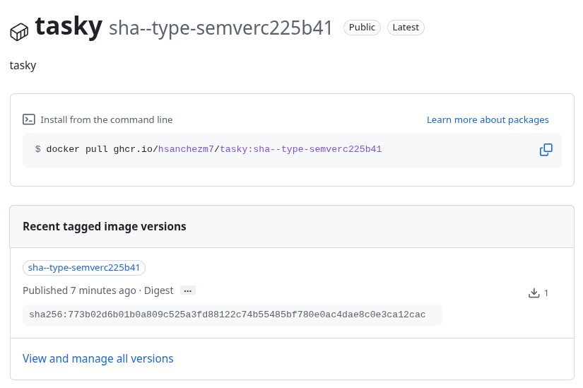

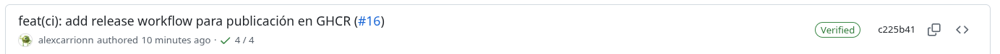

La causa era una línea del YAML. En `release.yml` estaba escrito `tags:` en lugar de `tags: |`. Sin el indicador de bloque literal `|`, YAML pliega las líneas siguientes en una única cadena separada por espacios:

```text
type=sha,prefix=sha- type=semver,pattern={{version}} type=semver,... type=raw,value=latest,...
```

`metadata-action` la leyó como **una sola regla** `type=sha` cuyo prefijo era todo lo demás, lo saneó (los espacios, `=` y `{}` no son válidos en una etiqueta de Docker) y produjo `sha--type-semverc225b41`. No había ni `latest` ni ninguna etiqueta de versión. En el push de la etiqueta el efecto fue peor: la regla `sha` no aplica, así que no se generó **ninguna** etiqueta y el paso de construcción falló con `tag is needed when pushing to registry` ([run 39298273146](https://github.com/hsanchezm7/tasky/actions/runs/39298273146)).

Se corrigió en el **PR #18**. Tras fusionarlo, el push a `main` publicó la imagen correctamente como `latest` y `sha-c3454c6`.


- **Commits 1 y 2** ([609fa41](https://github.com/hsanchezm7/tasky/commit/609fa41) y [c225b41](https://github.com/hsanchezm7/tasky/commit/c225b41)), PR [#16](https://github.com/hsanchezm7/tasky/pull/16).
- **Commits 5 y 6** ([6dea5ce](https://github.com/hsanchezm7/tasky/commit/6dea5ce) y [c3454c6](https://github.com/hsanchezm7/tasky/commit/c3454c6)), PR [#18](https://github.com/hsanchezm7/tasky/pull/18).

### Parte B — Publicar una versión de verdad

Se creó la etiqueta anotada y se subió:

```bash
git tag -a v1.0.0 -m "Primera versión publicable de la API de tareas"
git push origin v1.0.0
```

Hicieron falta **tres intentos** hasta que salió bien:

1. **Primer intento, sobre el commit equivocado.** La etiqueta se creó desde un `main` local que tenía además tres commits de la rama de demostración `feat/propar-lint` del Boletín 4, que nunca se fusionaron. Quedó apuntando a `058509a`, un commit que no está en `main` y que no contiene `release.yml`, así que al subirla **no se ejecutó ningún workflow**. La Release se creó sobre esa misma etiqueta: en la captura se ve el commit `058509a` y que `main` va "2 commits" por delante.

   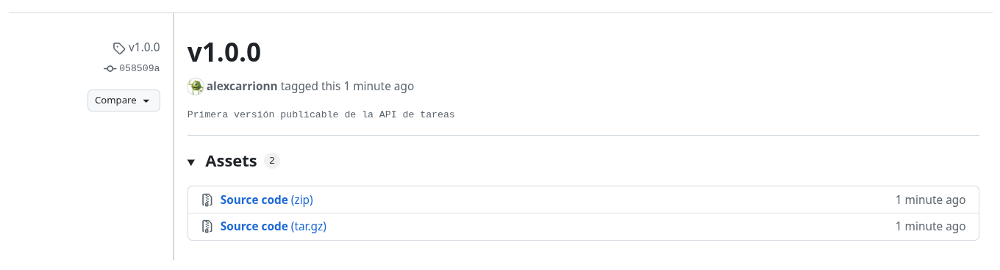
   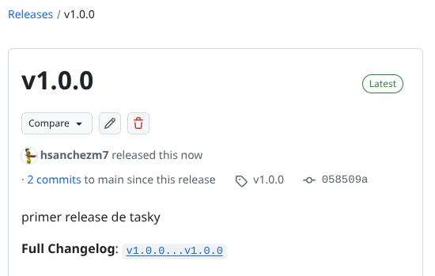

2. **Segundo intento, sobre `main` pero con el workflow roto.** Se borró la etiqueta y se volvió a crear sobre `cd8fae6`, que ya era `main`. Esta vez el workflow Release sí se lanzó, pero falló por el error de `tags:` descrito en la Parte A ([run 39298273146](https://github.com/hsanchezm7/tasky/actions/runs/39298273146)).

3. **Tercer intento, el definitivo.** Tras fusionar la corrección (PR #18), se borraron la etiqueta y la Release y se crearon de nuevo sobre `c3454c6`. El workflow Release terminó en verde ([run 39299091938](https://github.com/hsanchezm7/tasky/actions/runs/39299091938)) y la imagen quedó publicada también como `1.0.0`, `1.0` y `1`.

Para borrar y recrear la etiqueta:

```bash
git push origin --delete v1.0.0     # borra la etiqueta en GitHub
git tag -d v1.0.0                   # borra la etiqueta local
git switch main && git pull         # main actualizado, con la corrección
git tag -a v1.0.0 -m "Primera versión publicable de la API de tareas"
git push origin v1.0.0
```

Por último se creó la **[Release v1.0.0](https://github.com/hsanchezm7/tasky/releases/tag/v1.0.0)** a partir de la etiqueta con **Generate release notes**, que añade automáticamente la lista de PR fusionados desde el inicio del proyecto con su autor.


La lección del primer intento es que **una etiqueta marca un commit concreto, no una rama**: hay que crearla con `main` sincronizado con GitHub (`git pull`) y comprobar con `git log` a qué commit apunta antes de subirla.

- **Commit 6** ([c3454c6](https://github.com/hsanchezm7/tasky/commit/c3454c6)), etiqueta `v1.0.0`.

### Parte C — Verificar la imagen publicada

Para comprobar que la imagen del registro funciona por sí sola, sin el código fuente, se levantaron una PostgreSQL y la API en una red de Docker propia, igual que hace el `docker-compose.yml`. El package es **público**, así que no fue necesario `docker login`.

Una primera prueba se hizo con la imagen errónea `sha--type-semverc225b41`, antes de corregir el workflow:

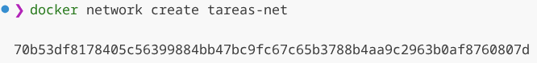
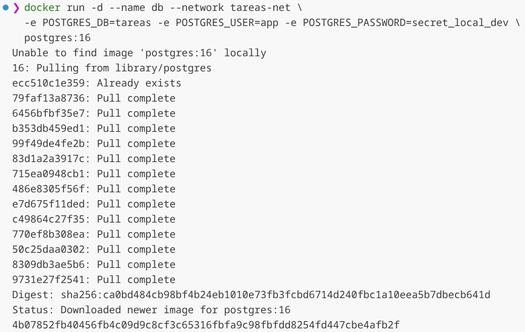
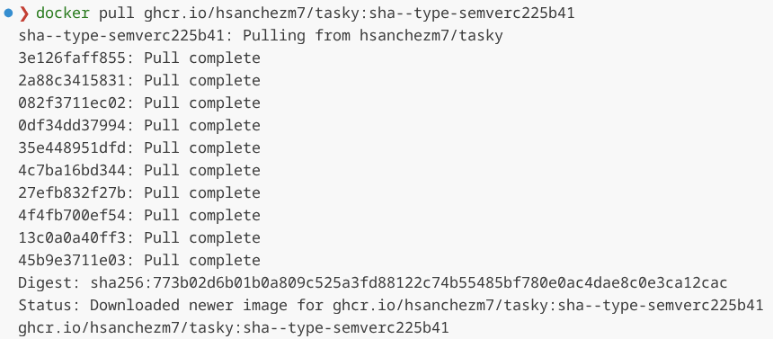
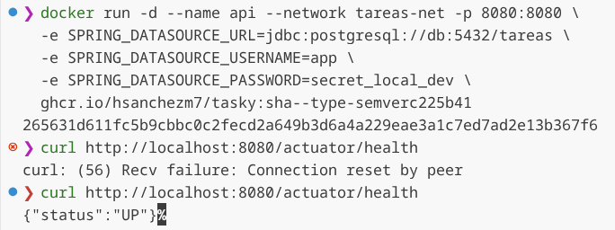

El primer `curl` devuelve `Connection reset by peer` porque Spring Boot aún estaba arrancando. Unos segundos después responde `{"status":"UP"}`.

La verificación definitiva se repitió con la imagen **`1.0.0`**, ya publicada correctamente. Como en la máquina de pruebas el puerto 8080 estaba ocupado por otro contenedor, la API se publicó en el **8081**:

```bash
docker network create tareas-net

docker run -d --name db --network tareas-net \
  -e POSTGRES_DB=tareas -e POSTGRES_USER=app -e POSTGRES_PASSWORD=secret_local_dev \
  postgres:16

docker pull ghcr.io/hsanchezm7/tasky:1.0.0
docker run -d --name api --network tareas-net -p 8081:8080 \
  -e SPRING_DATASOURCE_URL=jdbc:postgresql://db:5432/tareas \
  -e SPRING_DATASOURCE_USERNAME=app \
  -e SPRING_DATASOURCE_PASSWORD=secret_local_dev \
  ghcr.io/hsanchezm7/tasky:1.0.0
```

Resultado:

```text
$ docker pull ghcr.io/hsanchezm7/tasky:1.0.0
Digest: sha256:7be85abb7e5ec3cbb39684005f7bbf1976323ea3b453a121e83bd435055a65a6
Status: Downloaded newer image for ghcr.io/hsanchezm7/tasky:1.0.0

$ docker ps
api | ghcr.io/hsanchezm7/tasky:1.0.0 | Up 11 seconds (healthy) | 0.0.0.0:8081->8080/tcp
db  | postgres:16                    | Up 30 seconds           | 5432/tcp

$ curl http://localhost:8081/actuator/health
{"status":"UP"}
```

En los logs de la API se ve que el pool de conexiones arranca contra la base de datos (`HikariPool-1 - Start completed`) y que la aplicación está lista en unos 9 segundos. Para confirmar que de verdad escribe en PostgreSQL se creó una tarea y se consultó directamente en la tabla:

```text
$ curl -X POST http://localhost:8081/api/tasks -H "Content-Type: application/json" \
    -d '{"title":"Probar imagen 1.0.0","priority":"HIGH","dueDate":"2026-12-31"}'
{"id":1,"title":"Probar imagen 1.0.0","description":null,"status":"PENDING","priority":"HIGH","dueDate":"2026-12-31"}

$ docker exec db psql -U app -d tareas -c "select id, title, status from tasks;"
 id |        title        | status
----+---------------------+---------
  1 | Probar imagen 1.0.0 | PENDING
```

Al terminar se eliminó todo lo creado:

```bash
docker rm -f db api && docker network rm tareas-net
```

Las variables `SPRING_DATASOURCE_*` funcionan porque Spring Boot da prioridad a las variables de entorno sobre `application.properties`: la imagen es la misma en cualquier entorno y solo cambia la configuración que se le pasa al arrancar.

### Parte D — GitHub Pages de la documentación

Se trajeron las memorias de las sesiones anteriores a una carpeta `docs/` del repositorio de la API, junto con sus capturas en `docs/media/`. Del Boletín 1 hay dos memorias, una por cada miembro de la pareja, porque esa sesión era individual.

#### El script `docs/build.py`

Está escrito en Python y hace lo siguiente:

1. Borra `docs/site/` si existe y lo vuelve a crear vacío.
2. Copia `docs/media/` dentro de `docs/site/media/`.
3. Para cada `.md` de `docs/`, en orden natural (`boletin2` antes que `boletin10`):
   - convierte el Markdown en HTML;
   - cambia los enlaces a otros `.md` por `.html`;
   - envuelve las tablas en un contenedor con scroll horizontal, para que no rompan la página en móvil;
   - lo guarda en `docs/site/<nombre>.html` con una plantilla común (CSS integrado con modo claro y oscuro, y un enlace de vuelta al índice).
4. Genera `docs/site/index.html` con un enlace a cada memoria. El título se saca del primer encabezado `#` y, si el nombre del archivo lleva sufijo (`boletin1-alejandro`), se muestra "Memoria de Alejandro".

Para convertir el Markdown se eligió **`markdown-it-py`**, que sigue la especificación CommonMark, en lugar de la librería clásica `markdown`. Las memorias tienen listas anidadas con 2 espacios de sangría, y `markdown` exige 4, así que las habría aplanado.

Se probó en local antes de automatizarlo:

```bash
pip install -r docs/requirements.txt
python docs/build.py
```

```text
  boletin1-alejandro.md -> site/boletin1-alejandro.html
  boletin1-hugo.md -> site/boletin1-hugo.html
  boletin2.md -> site/boletin2.html
  boletin3.md -> site/boletin3.html
  boletin4.md -> site/boletin4.html
  index.html con 5 documentos
```

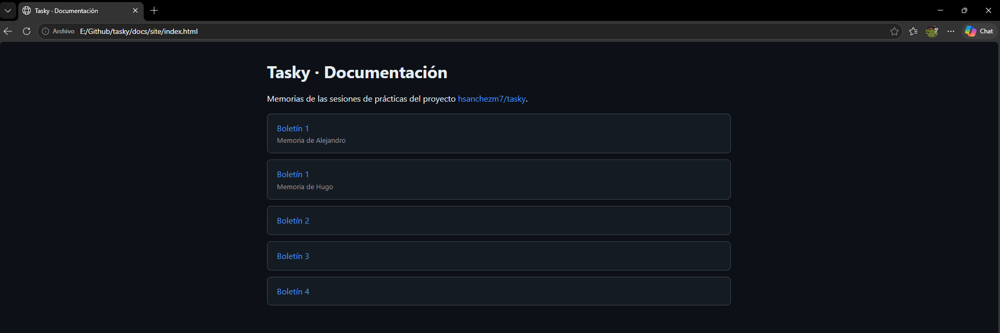

#### El workflow `pages.yml`

```yaml
on:
  push:
    branches: [ main ]
  workflow_dispatch:

permissions:
  contents: read
  pages: write
  id-token: write
```

Tiene dos jobs:

| Job | Qué hace |
|---|---|
| `build` | Instala Python 3.12 y `markdown-it-py`, ejecuta `python docs/build.py` y sube `docs/site/` con `actions/upload-pages-artifact`. |
| `deploy` | Depende de `build`. Publica el artefacto con `actions/deploy-pages` en el entorno `github-pages`, que muestra la URL de la web en el resumen del run. |

- **`pages: write`** permite publicar en Pages.
- **`id-token: write`** hace falta porque `deploy-pages` demuestra la identidad del workflow con un token OIDC.
- **`concurrency`** tiene el grupo `pages` y `cancel-in-progress: false`, para que no se corte una publicación a medias si llegan dos pushes seguidos.
- **`workflow_dispatch`** permite relanzarlo a mano desde la pestaña Actions.

#### Configuración y publicación

- El repositorio ya era **público**, requisito para usar GitHub Pages en una cuenta gratuita.
- En **Settings → Pages** se cambió **Source** a **GitHub Actions**.
- `docs/site/` se añadió al `.gitignore`: la web se genera en el pipeline a partir de los `.md` y no tiene sentido versionarla.

Al fusionar el PR #17, el workflow **Pages** se ejecutó en `main` y terminó en verde:

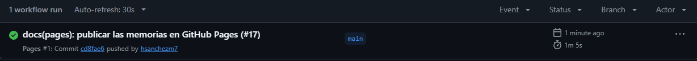

La documentación queda publicada en **<https://hsanchezm7.github.io/tasky/>** y se regenera sola en cada push a `main`. Al añadir esta memoria como `docs/boletin5.md`, aparecerá en la web sin tocar nada más.


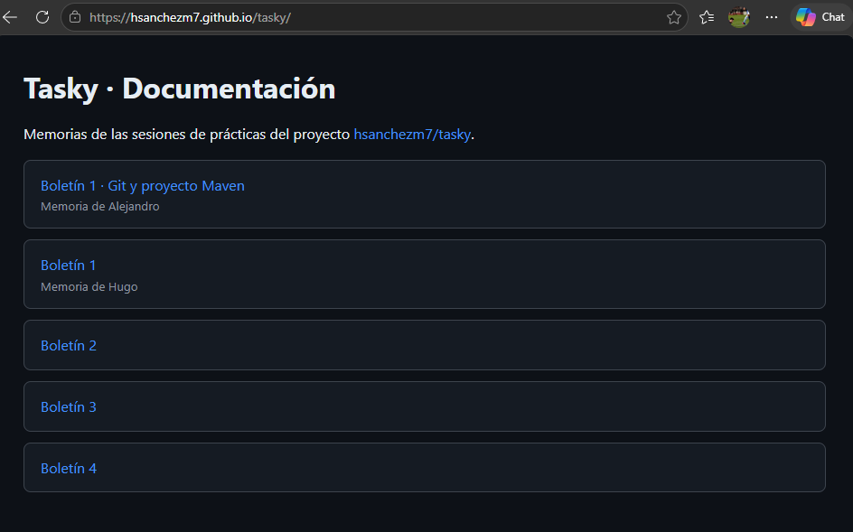
- **Commits 3 y 4** ([71a70b6](https://github.com/hsanchezm7/tasky/commit/71a70b6) y [cd8fae6](https://github.com/hsanchezm7/tasky/commit/cd8fae6)), PR [#17](https://github.com/hsanchezm7/tasky/pull/17).

## Uso de IA en la sesión

| Herramienta | Para qué se usó | Commits afectados |
|---|---|---|
| Claude | **Cambios en código:** script `docs/build.py`, workflow `pages.yml`, copia de las memorias a `docs/` y corrección del indicador de bloque literal de `tags:` en `release.yml`. | 3, 5 |
| Claude | **Diagnóstico:** detectar que la etiqueta `v1.0.0` apuntaba a un commit fuera de `main` y que el registro solo tenía etiquetas erróneas, consultando la API de GitHub y de GHCR. | — (no genera commits) |
| Claude | **Verificación (Parte C):** ejecución de la prueba con la imagen `1.0.0` (red, PostgreSQL, API, `curl` y limpieza). | — (no genera commits) |
| Claude | **Desarrollo del boletín:** ayuda en la redacción de esta memoria a partir del historial del repositorio, de los runs de GitHub Actions y de las capturas. | — (no genera commits) |

En todos los casos se ha revisado y entendido lo generado antes de incorporarlo. Ningún commit ha sido hecho por la IA.
