# Boletín 6

**Autores:** Hugo Sánchez (`hsanchezm7`) y Alejandro Carrión Jordán (`alexcarrionn`)

**Pull Requests de la sesión:** [#20 — Feat/ansible](https://github.com/hsanchezm7/tasky/pull/20), [#21 — feat(deploy): guardar salidas de despliegue y fijar image_name_mismatch](https://github.com/hsanchezm7/tasky/pull/21) y [#22 — Feat/ansible](https://github.com/hsanchezm7/tasky/pull/22)

**Versiones desplegadas desde GitHub Actions en esta sesión:** [v1.1.0](https://github.com/hsanchezm7/tasky/releases/tag/v1.1.0) · [v1.2.0](https://github.com/hsanchezm7/tasky/releases/tag/v1.2.0)

**Documentación publicada:** <https://hsanchezm7.github.io/tasky/>

## Resumen de commits

| # | Mensaje del commit | Rama | Qué se hizo | Autor | Enlace |
|---|--------------------|------|-------------|-------|--------|
| 1 | `build(ansible): añadir dependencia ansible` | `feat/ansible` | Declara la collection `community.docker` 3.7.0 en `deploy/requeriments.yml`. | Alejandro Carrión | [9a543eb](https://github.com/hsanchezm7/tasky/commit/9a543eb) |
| 2 | `feat(deploy): añadir flota, inventario y playbook de Ansible` | `feat/ansible` | Corrige el nombre a `deploy/requirements.yml` y añade la flota (`deploy/servidores/docker-compose.yml`), el inventario (`deploy/inventory.ini`) y el playbook (`deploy/deploy.yml`). | Alejandro Carrión | [c1caf07](https://github.com/hsanchezm7/tasky/commit/c1caf07) |
| 3 | `feat(deploy): añadir vault, fix nombres` | `feat/ansible` | Añade el Vault cifrado `deploy/group_vars/servidores/vault.yml` y renombra los contenedores a `tasky-db` y `tasky-api`. | Hugo Sánchez | [32f4ffe](https://github.com/hsanchezm7/tasky/commit/32f4ffe) |
| 4 | `feat(app): exponer la versión en /actuator/info y subir a 1.1.0` | `feat/ansible` | Expone nombre y versión de la app en `/actuator/info`, sube el `pom.xml` a `1.1.0` y guarda las salidas del primer despliegue y de la prueba de idempotencia. | Alejandro Carrión | [0b86ede](https://github.com/hsanchezm7/tasky/commit/0b86ede) |
| 5 | `Feat/ansible (#20)` | `main` | Commit de fusión del **[PR #20](https://github.com/hsanchezm7/tasky/pull/20)**. Sobre este commit se crea la etiqueta `v1.1.0`. | Alejandro Carrión | [acaaf38](https://github.com/hsanchezm7/tasky/commit/acaaf38) |
| 6 | `feat(deploy): guardar salidas de despliegue y fijar image_name_mismatch` | `feat/ansible` | Guarda las salidas del despliegue de la `1.1.0` y del rollback, y fija `image_name_mismatch: recreate` en el contenedor de la API. | Alejandro Carrión | [69ce81c](https://github.com/hsanchezm7/tasky/commit/69ce81c) |
| 7 | `feat(deploy): guardar salidas de despliegue y fijar image_name_mismatch (#21)` | `main` | Commit de fusión del **[PR #21](https://github.com/hsanchezm7/tasky/pull/21)**. | Hugo Sánchez | [c1119b8](https://github.com/hsanchezm7/tasky/commit/c1119b8) |
| 8 | `Merge branch 'feat/ansible' of https://github.com/hsanchezm7/tasky into feat/ansible` | `feat/ansible` | Sincroniza la rama local de Hugo con la remota. | Hugo Sánchez | [6fa6b9c](https://github.com/hsanchezm7/tasky/commit/6fa6b9c) |
| 9 | `feat(release): configurar deploy en pipeline release` | `feat/ansible` | Añade la salida `version` al job `publish` y el nuevo job `deploy` en `release.yml`. | Hugo Sánchez | [3996133](https://github.com/hsanchezm7/tasky/commit/3996133) |
| 10 | `Feat/ansible (#22)` | `main` | Commit de fusión del **[PR #22](https://github.com/hsanchezm7/tasky/pull/22)**. | Alejandro Carrión | [105b9dd](https://github.com/hsanchezm7/tasky/commit/105b9dd) |

> Además de los commits, en la sesión se crearon las **etiquetas anotadas `v1.1.0`** (sobre `acaaf38`) y **`v1.2.0`** (sobre `105b9dd`), que lanzaron el workflow Release y publicaron sus imágenes en GHCR.

## Detalle por commit

### 1. `build(ansible): añadir dependencia ansible`

- **Rama:** `feat/ansible`, creada a partir de `9aaae7e`

- **Qué se hizo:** se declara en el repositorio la collection que aporta los módulos de Docker, para que cualquiera (y el pipeline) la instale con la misma versión:

  ```yaml
  collections:
    - name: community.docker
      version: "3.7.0"
  ```

  El fichero se creó con una errata en el nombre (`requeriments.yml`), que se corrige en el commit siguiente.

- **Autor:** Alejandro Carrión Jordán

- **Relación con el boletín:** Apartado **Parte A** (Instalar Ansible y sus dependencias).

- **Uso de IA:** No se ha usado.

### 2. `feat(deploy): añadir flota, inventario y playbook de Ansible`

- **Rama:** `feat/ansible`

- **Qué se hizo:**

  - Renombra `deploy/requeriments.yml` a `deploy/requirements.yml`, que es la ruta que usa el job de CI.
  - `deploy/servidores/docker-compose.yml`: tres contenedores Ubuntu con SSH (`app1`, `app2` y `db1`) que hacen de servidores.
  - `deploy/inventory.ini`: los grupos `app` y `db`, y el grupo padre `servidores` con las variables de conexión.
  - `deploy/deploy.yml`: el playbook de tres plays (Docker en toda la flota, PostgreSQL en `db` y la API en `app`), adaptado a nuestro proyecto (ver Parte D).

- **Autor:** Alejandro Carrión Jordán

- **Relación con el boletín:** Apartados **Parte B**, **Parte C** y **Parte D**.

- **Uso de IA:** Claude redactó los tres ficheros a partir del enunciado y los adaptó al nombre de nuestra imagen y a las variables de entorno de la aplicación.

### 3. `feat(deploy): añadir vault, fix nombres`

- **Rama:** `feat/ansible`

- **Qué se hizo:** se crea con `ansible-vault create` el fichero cifrado `deploy/group_vars/servidores/vault.yml` con las credenciales (`ghcr_user`, `ghcr_token`, `db_name`, `db_user`, `db_pass`). Además se renombran los contenedores y el volumen de `tareas-*` a `tasky-db`, `tasky-db-data` y `tasky-api`, para que coincidan con el nombre del proyecto.

- **Autor:** Hugo Sánchez

- **Relación con el boletín:** Apartado **Parte E** (Proteger las credenciales con Ansible Vault).

- **Uso de IA:** No se ha usado.

### 4. `feat(app): exponer la versión en /actuator/info y subir a 1.1.0`

- **Rama:** `feat/ansible`

- **Qué se hizo:** para poder desplegar una versión distinta y comprobar desde fuera cuál está corriendo, se añade a `application.properties`:

  ```properties
  management.info.env.enabled=true
  info.app.name=@project.artifactId@
  info.app.version=@project.version@
  ```

  Maven sustituye `@project.version@` por la versión del `pom.xml` al empaquetar, que pasa de `0.0.1-SNAPSHOT` a `1.1.0`. También se guardan en `deploy/salidas/` las salidas de las dos primeras ejecuciones del playbook.

- **Autor:** Alejandro Carrión Jordán

- **Relación con el boletín:** Apartado **Parte F** (despliegue de una versión nueva e idempotencia).

- **Uso de IA:** Claude propuso y escribió el cambio en `application.properties` y `pom.xml`.

### 5. `Feat/ansible (#20)`

- **Rama:** fusión en `main`

- **Qué se hizo:** fusión del **[PR #20](https://github.com/hsanchezm7/tasky/pull/20)**. Sobre este commit se creó la etiqueta `v1.1.0`, cuyo workflow Release publicó `ghcr.io/hsanchezm7/tasky:1.1.0`.

- **Autor:** Alejandro Carrión Jordán

- **Relación con el boletín:** Partes B a F.

- **Uso de IA:** No se ha usado.

### 6. `feat(deploy): guardar salidas de despliegue y fijar image_name_mismatch`

- **Rama:** `feat/ansible`

- **Qué se hizo:** se guardan las salidas del despliegue de la `1.1.0` y del rollback a la `1.0.0`, y se añade `image_name_mismatch: recreate` al contenedor de la API para eliminar un aviso de deprecación de `community.docker` (explicado en la Parte F).

- **Autor:** Alejandro Carrión Jordán

- **Relación con el boletín:** Apartado **Parte F**.

- **Uso de IA:** Claude interpretó el aviso de deprecación y propuso la opción.

### 7. `feat(deploy): guardar salidas de despliegue y fijar image_name_mismatch (#21)`

- **Rama:** fusión en `main`

- **Qué se hizo:** fusión del **[PR #21](https://github.com/hsanchezm7/tasky/pull/21)**.

- **Autor:** Hugo Sánchez

- **Relación con el boletín:** Parte F.

- **Uso de IA:** No se ha usado.

### 8. `Merge branch 'feat/ansible' of https://github.com/hsanchezm7/tasky into feat/ansible`

- **Rama:** `feat/ansible`

- **Qué se hizo:** `git pull` de la rama remota sobre la local de Hugo antes de añadir el job de despliegue. No cambia ficheros por sí mismo.

- **Autor:** Hugo Sánchez

- **Relación con el boletín:** Parte G.

- **Uso de IA:** No se ha usado.

### 9. `feat(release): configurar deploy en pipeline release`

- **Rama:** `feat/ansible`

- **Qué se hizo:** amplía `.github/workflows/release.yml` con la salida `version` del job `publish` y el job `deploy`, que se ejecuta en un runner autoalojado, en el entorno protegido `produccion`, solo al publicar una etiqueta `vX.Y.Z`.

- **Autor:** Hugo Sánchez

- **Relación con el boletín:** Apartado **Parte G.3**.

- **Uso de IA:** No se ha usado.

### 10. `Feat/ansible (#22)`

- **Rama:** fusión en `main`

- **Qué se hizo:** fusión del **[PR #22](https://github.com/hsanchezm7/tasky/pull/22)**. Sobre este commit se creó la etiqueta `v1.2.0`.

- **Autor:** Alejandro Carrión Jordán

- **Relación con el boletín:** Parte G.

- **Uso de IA:** No se ha usado.

## Descripción narrativa de lo hecho en la sesión y relación con los commits

### Parte A — Instalar Ansible y sus dependencias

Ansible solo funciona como controlador en Linux, así que todo se hizo desde **WSL2 con Ubuntu 22.04**. El `apt` de esa versión instala Ansible 2.10.8, más antiguo que la 2.16.x que pide el enunciado, así que se quitó y se instaló `ansible-core` 2.16 con `pipx`, junto con `sshpass`:

```bash
sudo apt remove -y ansible && sudo apt install -y pipx sshpass
pipx install "ansible-core==2.16.*" && pipx ensurepath
ansible --version          # ansible [core 2.16.19]
ansible-galaxy collection install -r deploy/requirements.yml
```

Durante la sesión se usaron dos versiones de Ansible: la captura muestra la instalación inicial 2.14.18 y, posteriormente, se actualizó a 2.16.19, la versión requerida para este entorno:

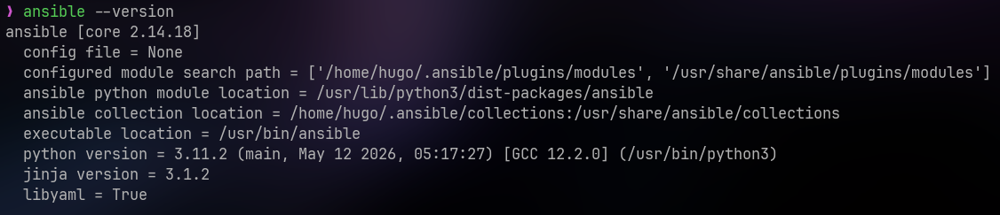

La captura muestra dos versiones instaladas de `community.docker`; el proyecto fija y utiliza la **3.7.0**, declarada en `deploy/requirements.yml`:

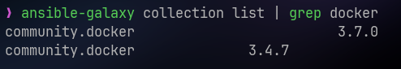

La versión 2.16 no es arbitraria: las máquinas destino son Ubuntu 18.04, con Python 3.6, y las versiones más recientes de `ansible-core` ya no lo admiten en los hosts gestionados.

La collection se declaró en `deploy/requirements.yml`. En el primer commit el fichero se llamó `requeriments.yml` por error, y se renombró en el segundo, porque el pipeline lo instala con `ansible-galaxy collection install -r deploy/requirements.yml`.

- **Commits 1 y 2** ([9a543eb](https://github.com/hsanchezm7/tasky/commit/9a543eb) y [c1caf07](https://github.com/hsanchezm7/tasky/commit/c1caf07)).

### Parte B — Preparar la flota de servidores destino

La flota son tres contenedores de `rastasheep/ubuntu-sshd:18.04`, que trae `sshd` ya arrancado, definidos en `deploy/servidores/docker-compose.yml`:

| Máquina | Rol | Puerto SSH en el anfitrión | Puerto de la API en el anfitrión |
|---|---|---|---|
| `app1` | aplicación | `2223` | `8081` |
| `app2` | aplicación | `2224` | `8082` |
| `db1` | base de datos | `2225` | — |

Los tres son `privileged: true`, porque dentro de cada uno se ejecuta su propio Docker (Docker-in-Docker). Este `docker-compose.yml` no tiene relación con el de la aplicación del Boletín 3: aquí solo se simulan las máquinas.

Antes de levantarla hubo que arrancar Docker Desktop y activar su integración con WSL (*Settings → Resources → WSL integration → Ubuntu-22.04*). Después se levantó la flota y se comprobó el acceso por SSH a cada máquina con la contraseña `root`:

```bash
docker compose -f deploy/servidores/docker-compose.yml up -d
ssh root@localhost -p 2223   # app1
ssh root@localhost -p 2224   # app2
ssh root@localhost -p 2225   # db1
```

Comprobamos el acceso SSH a cada servidor:

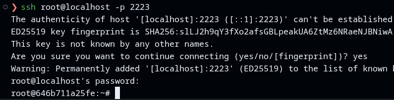
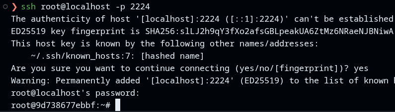
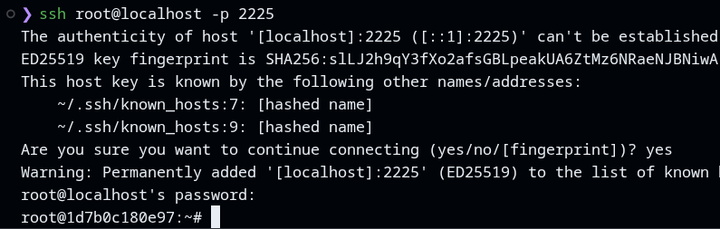

- **Commit 2** ([c1caf07](https://github.com/hsanchezm7/tasky/commit/c1caf07)).

### Parte C — El inventario

`deploy/inventory.ini` agrupa las máquinas por rol: `app` (`app1`, `app2`) y `db` (`db1`), los dos dentro del grupo padre `servidores`. Las variables comunes van en `[servidores:vars]`:

- `ansible_python_interpreter=/usr/bin/python3`, para que Ansible use el Python 3 de las máquinas;
- `ansible_password=root`, que `sshpass` envía al conectar;
- `ansible_ssh_common_args` con `StrictHostKeyChecking=no` y `UserKnownHostsFile=/dev/null`, porque las máquinas se recrean y cambian de clave cada vez.

El `ping` de Ansible a toda la flota respondió `pong` en `app1`, `app2` y `db1`. Una vez creado el Vault (Parte E) el `ping` empezó a fallar con `Attempting to decrypt but no vault secrets found`: Ansible carga `group_vars/servidores/vault.yml` para cualquier host de ese grupo, aunque el módulo no use ninguna variable, así que desde entonces hay que añadir `--ask-vault-pass` también al `ping`.

```bash
ansible -i deploy/inventory.ini servidores -m ping --ask-vault-pass
```

- **Commit 2** ([c1caf07](https://github.com/hsanchezm7/tasky/commit/c1caf07)).

### Parte D — El playbook de despliegue

`deploy/deploy.yml` tiene tres plays que se ejecutan en orden:

1. **Preparar Docker en toda la flota** (`hosts: servidores`): instala `docker.io` y `python3-docker` con `apt` y arranca `dockerd` a mano, porque los contenedores no tienen `systemd`. La opción `creates: /var/run/docker.pid` hace la tarea idempotente: si el fichero ya existe, no se vuelve a lanzar.
2. **Desplegar la base de datos** (`hosts: db`): un contenedor `postgres:16` con un volumen para los datos y un healthcheck con `pg_isready`.
3. **Desplegar la API** (`hosts: app`): login en GHCR, descarga de la imagen, arranque del contenedor y un smoke test que reintenta `/actuator/health` hasta que devuelve `UP`.

Respecto al playbook del enunciado se hicieron tres adaptaciones:

| Enunciado | Nuestro playbook | Motivo |
|---|---|---|
| `ghcr.io/TU_USUARIO/tareas-api` | `ghcr.io/hsanchezm7/tasky` | Es la imagen que publica el `release.yml` del Boletín 5. |
| `SPRING_DATASOURCE_URL`, `_USERNAME`, `_PASSWORD` | `DB_URL`, `DB_USERNAME`, `DB_PASSWORD` | Son las variables que lee nuestro `application.properties`. Spring aceptaría las dos, pero así hay una única forma de configurarlo. |
| `tareas-db`, `tareas-api` | `tasky-db`, `tasky-api` | Coherencia con el nombre del proyecto (commit 3). |

La API se conecta a la base de datos por el nombre del primer host del grupo `db`, `{{ groups['db'][0] }}`, es decir, `db1`. Funciona gracias a `network_mode: host`: el contenedor de la API comparte la red de la máquina `app1`/`app2`, que está en la misma red de Docker Compose que `db1` y resuelve su nombre. Por la misma razón, PostgreSQL escucha directamente en el puerto 5432 de `db1`.

- **Commits 2 y 3** ([c1caf07](https://github.com/hsanchezm7/tasky/commit/c1caf07) y [32f4ffe](https://github.com/hsanchezm7/tasky/commit/32f4ffe)).

### Parte E — Proteger las credenciales con Ansible Vault

Las credenciales se guardaron cifradas en `deploy/group_vars/servidores/vault.yml`:

```bash
ansible-vault create deploy/group_vars/servidores/vault.yml
```

Vault solicita y confirma la contraseña maestra al crear el fichero:

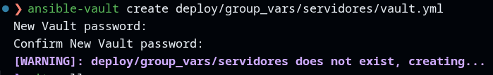

```yaml
ghcr_user: ...
ghcr_token: ...      # PAT con permiso read:packages
db_name: ...
db_user: ...
db_pass: ...
```

Al estar en `group_vars/servidores/`, Ansible carga esas variables automáticamente para todos los hosts del grupo `servidores`, sin tener que mencionarlas en el playbook. El fichero versionado es ilegible:

```text
$ head -1 deploy/group_vars/servidores/vault.yml
$ANSIBLE_VAULT;1.1;AES256
```

La salida de `cat` confirma que el contenido del fichero está cifrado:

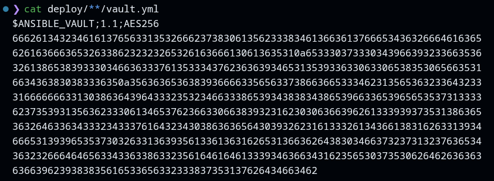

Ninguna credencial aparece en el playbook ni se pasa con `--extra-vars`, que dejaría rastro en el historial de la shell y en la lista de procesos. La contraseña maestra se introduce con `--ask-vault-pass` al ejecutar.

- **Commit 3** ([32f4ffe](https://github.com/hsanchezm7/tasky/commit/32f4ffe)).

### Parte F — Ejecutar el despliegue a mano

Todas las ejecuciones se guardaron con `tee` en `deploy/salidas/`.

#### Primer despliegue (`1.0.0`)

```bash
ansible-playbook -i deploy/inventory.ini deploy/deploy.yml \
  --ask-vault-pass --extra-vars "version_app=1.0.0" | tee deploy/salidas/1-primer-despliegue.txt
```

```text
TASK [Smoke test — esperar a que la API esté sana] *****************************
FAILED - RETRYING: [app1]: Smoke test — esperar a que la API esté sana (20 retries left).
FAILED - RETRYING: [app2]: Smoke test — esperar a que la API esté sana (20 retries left).
...
ok: [app2]
ok: [app1]

PLAY RECAP *********************************************************************
app1                       : ok=8    changed=5    unreachable=0    failed=0    skipped=0
app2                       : ok=8    changed=5    unreachable=0    failed=0    skipped=0
db1                        : ok=5    changed=3    unreachable=0    failed=0    skipped=0
```

En `app1` y `app2` cambian cinco tareas (instalar Docker, arrancar `dockerd`, login, descarga de la imagen y creación del contenedor) y en `db1` tres. Los `FAILED - RETRYING` del smoke test son esperables: es el tiempo que tarda Spring Boot en arrancar, y por eso la tarea tiene `retries` y `until`.

Las dos réplicas responden a la misma API:

```text
$ curl http://localhost:8081/api/tasks
[]
```

#### Idempotencia

Al relanzar exactamente el mismo comando, todas las tareas salen `ok` y ninguna `changed`:

```text
PLAY RECAP *********************************************************************
app1                       : ok=8    changed=0    unreachable=0    failed=0    skipped=0
app2                       : ok=8    changed=0    unreachable=0    failed=0    skipped=0
db1                        : ok=5    changed=0    unreachable=0    failed=0    skipped=0
```

Cada módulo compara el estado actual con el deseado antes de actuar: `apt` ve que los paquetes ya están, `creates` ve que `dockerd` ya corre, y `docker_container` ve que el contenedor ya existe con la misma imagen y configuración.

#### Desplegar una versión nueva (`1.1.0`)

Para que la nueva versión se distinguiera desde fuera, la `1.1.0` expone su versión en `/actuator/info` (commit 4). Se fusionó el PR #20, se creó la etiqueta y el workflow Release publicó la imagen `1.1.0`:

```bash
git tag -a v1.1.0 -m "v1.1.0"
git push origin v1.1.0
```

Al relanzar el playbook con `version_app=1.1.0`, solo cambian las dos tareas que dependen de la versión, y solo en las máquinas de aplicación:

```text
TASK [Descargar la imagen de la aplicación] ************************************
changed: [app2]
changed: [app1]

TASK [Arrancar el contenedor de la API] ****************************************
changed: [app1]
changed: [app2]

PLAY RECAP *********************************************************************
app1                       : ok=8    changed=2    unreachable=0    failed=0    skipped=0
app2                       : ok=8    changed=2    unreachable=0    failed=0    skipped=0
db1                        : ok=5    changed=0    unreachable=0    failed=0    skipped=0
```

En esa ejecución `community.docker` mostró un aviso: el valor por defecto de `image_name_mismatch` (`ignore`) pasará a ser `recreate` en la versión 4.0.0 de la collection. Para que el playbook no dependa de un valor por defecto que va a cambiar, se fijó explícitamente `image_name_mismatch: recreate` (commit 6): si cambia el tag de la imagen, el contenedor se recrea.

#### Rollback (`1.0.0`)

```bash
time ansible-playbook -i deploy/inventory.ini deploy/deploy.yml \
  --ask-vault-pass --extra-vars "version_app=1.0.0" | tee deploy/salidas/4-rollback.txt
```

```text
TASK [Descargar la imagen de la aplicación] ************************************
ok: [app1]
ok: [app2]

TASK [Arrancar el contenedor de la API] ****************************************
changed: [app1]
changed: [app2]

PLAY RECAP *********************************************************************
app1                       : ok=8    changed=1    unreachable=0    failed=0    skipped=0
app2                       : ok=8    changed=1    unreachable=0    failed=0    skipped=0
db1                        : ok=5    changed=0    unreachable=0    failed=0    skipped=0

real    0m59.791s
```

El rollback tardó **59,8 segundos** en las dos réplicas. Esa cifra incluye escribir la contraseña del Vault y unos 20 segundos de smoke test esperando a que arranque Spring Boot; el cambio de contenedor en sí son unos pocos segundos. Ahora solo cambia una tarea por máquina, porque la imagen `1.0.0` seguía descargada en `app1` y `app2`, y `db1` no se toca, así que los datos se conservan.

Esto solo es posible porque las etiquetas de versión son **inmutables**: `1.0.0` sigue siendo exactamente la misma imagen que se desplegó al principio. Con `latest` no se podría saber qué versión está corriendo ni a cuál volver.

- **Commits 4 a 7** ([0b86ede](https://github.com/hsanchezm7/tasky/commit/0b86ede), [acaaf38](https://github.com/hsanchezm7/tasky/commit/acaaf38), [69ce81c](https://github.com/hsanchezm7/tasky/commit/69ce81c) y [c1119b8](https://github.com/hsanchezm7/tasky/commit/c1119b8)), PR [#20](https://github.com/hsanchezm7/tasky/pull/20) y [#21](https://github.com/hsanchezm7/tasky/pull/21).

### Parte G — Disparar el despliegue desde GitHub Actions

El flujo de CD se ha completado de la siguiente forma: 

1. Se ha registrando un runner autoalojado se en el repositorio, que queda a la espera escuchando trabajos. Haciendo uso de un entorno protegido `produccion`, se guarda `VAULT_PASS` como secreto. También se ha redefinido `release.yml` para realizar dos etapas:

- `publish`, que expone la versión de la imagen 

- `deploy` la recibe para ejecutar Ansible únicamente al publicar un tag `vX.Y.Z`.

Las publicaciones `v1.1.0` y `v1.2.0` se desplegaron y se comprobaron en las dos réplicas (`localhost:8081` y `localhost:8082`).

#### Diagrama de la arquitectura

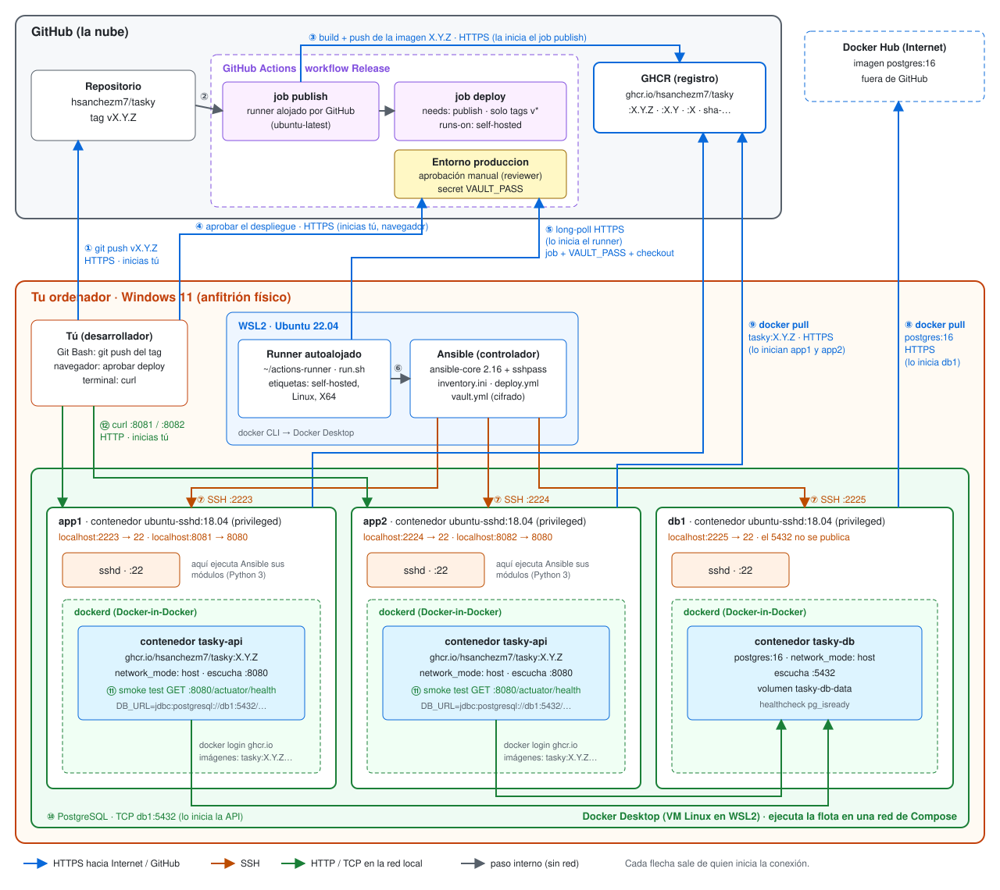

El diagrama tiene tres niveles:

- **GitHub (la nube):** el repositorio, GitHub Actions con los jobs `publish` y `deploy`, el entorno `produccion` con su aprobación manual y el secret `VAULT_PASS`, y el registro GHCR. Docker Hub está fuera de GitHub y solo aporta la imagen `postgres:16`.
- **El ordenador (Windows 11):** dentro de WSL2 (Ubuntu 22.04) corren el runner autoalojado y Ansible. Docker Desktop, en su propia VM Linux, ejecuta los tres contenedores de la flota.
- **Las "máquinas" de la flota:** `app1`, `app2` y `db1` son contenedores `ubuntu-sshd:18.04` con `sshd` y su propio `dockerd` (Docker-in-Docker). Dentro de `app1` y `app2` corre `tasky-api` y dentro de `db1` corre `tasky-db`. Hacia el ordenador solo se publican los puertos SSH (`2223`, `2224`, `2225`) y los de la API (`8081`, `8082`). El 5432 de PostgreSQL solo es accesible dentro de la red de Compose.

#### Configurar y arrancar el runner autoalojado

Desde **Settings → Actions → Runners** se elige Linux x64 y GitHub muestra los comandos de instalación:

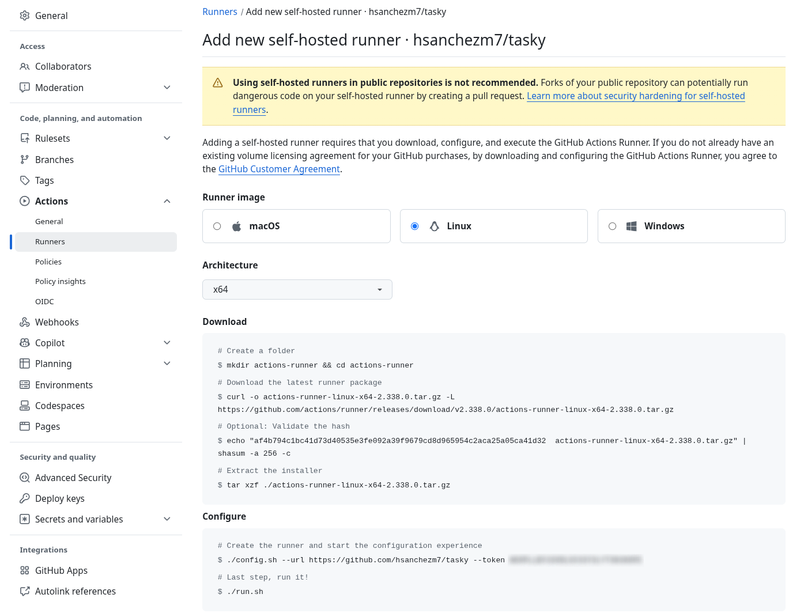

Se descargó, verificó y extrajo el paquete del runner:

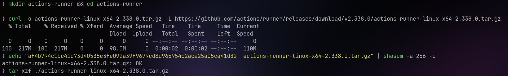

Después se ejecutó `config.sh` para registrarlo en el repositorio:

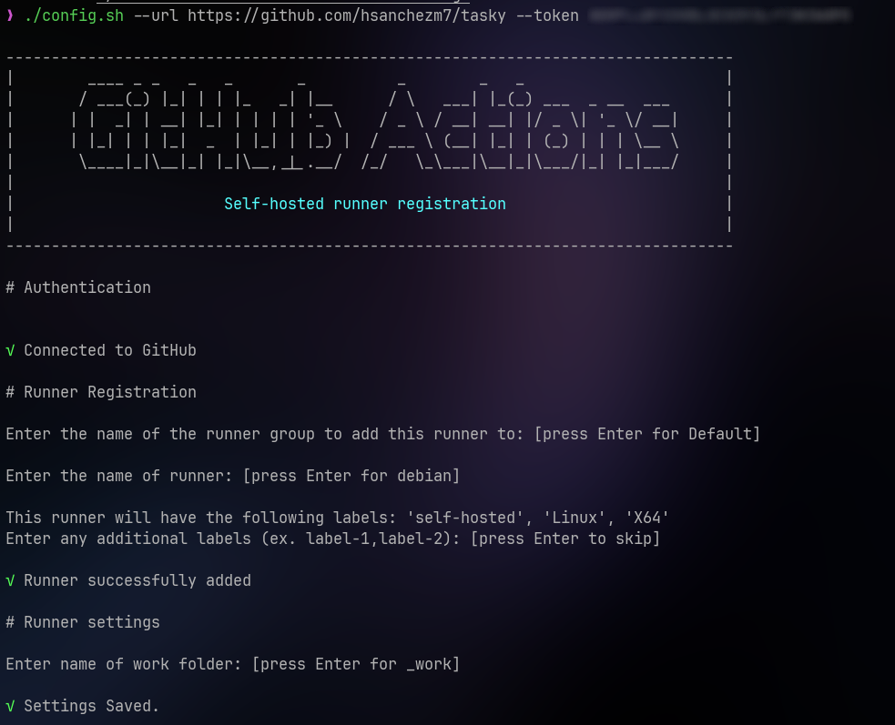

Al dejar `./run.sh` en ejecución, el runner se conecta a GitHub y queda escuchando trabajos:

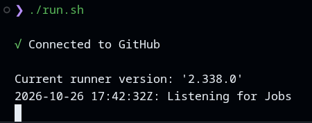

GitHub lo muestra como `Idle` cuando está libre para recibir un job:

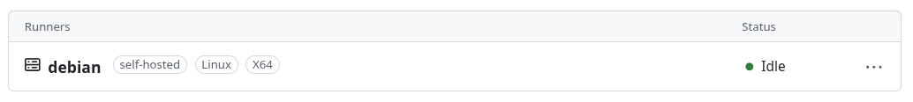

Cada flecha sale de quien inicia la conexión. Hay que fijarse en la flecha ⑤: **GitHub no se conecta nunca al ordenador**. Es el runner el que abre una conexión HTTPS saliente hacia GitHub y pregunta si hay trabajo (*long-poll*), por eso funciona sin abrir ningún puerto en el router.

#### Pasos desde el `git push` del tag hasta las dos réplicas corriendo

| Paso | Qué ocurre | Dónde | Conexión |
|---|---|---|---|
| ① | `git push origin vX.Y.Z` | Tu ordenador → repositorio | HTTPS, la inicias tú |
| ② | El tag `v*.*.*` dispara el workflow Release | GitHub | interno |
| ③ | El job `publish` construye la imagen y la sube con las etiquetas `X.Y.Z`, `X.Y`, `X` y `sha-…` | Runner alojado por GitHub → GHCR | HTTPS, la inicia el job |
| ④ | El job `deploy` espera en el entorno `produccion` hasta que un reviewer lo aprueba | Navegador → GitHub | HTTPS, la inicias tú |
| ⑤ | El runner autoalojado recoge el job, recibe `VAULT_PASS` y hace checkout del repositorio | WSL2 → GitHub | HTTPS saliente, la inicia el runner |
| ⑥ | El runner instala la collection y lanza `ansible-playbook` con la contraseña del Vault en un fichero temporal | WSL2 | interno |
| ⑦ | Ansible entra por SSH en las tres máquinas, instala Docker y arranca `dockerd` | WSL2 → `localhost:2223`, `2224`, `2225` | SSH, la inicia Ansible |
| ⑧ | `db1` descarga `postgres:16` (solo la primera vez) y arranca `tasky-db` | `db1` → Docker Hub | HTTPS, la inicia `db1` |
| ⑨ | `app1` y `app2` hacen `docker login` y descargan `tasky:X.Y.Z`, y se recrea `tasky-api` | `app1`, `app2` → GHCR | HTTPS, la inician las máquinas |
| ⑩ | Cada `tasky-api` se conecta a PostgreSQL en `db1` | `app1`, `app2` → `db1:5432` | TCP, la inicia la API |
| ⑪ | Smoke test: Ansible comprueba `GET :8080/actuator/health` dentro de cada máquina hasta que devuelve `UP`, y el job termina en verde | `app1`, `app2` | HTTP local |
| ⑫ | Compruebas que las dos réplicas responden | Tu ordenador → `localhost:8081` y `8082` | HTTP, la inicias tú |

La ejecución de Release finalizó correctamente, con los jobs `publish` y `deploy` en verde:

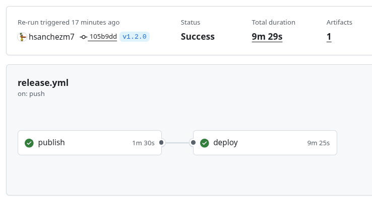

## Uso de IA en la sesión

| Herramienta | Para qué se usó | Commits afectados |
|---|---|---|
| Claude | **Cambios en código:** redacción de la flota, el inventario y el playbook adaptados al proyecto, exposición de la versión en `/actuator/info` y la opción `image_name_mismatch`. | 2, 4, 6 |
| Claude | **Diagnóstico:** detectar la versión incorrecta de Ansible en WSL, la errata en `requeriments.yml` y por qué el `ping` fallaba tras crear el Vault; interpretar las salidas del playbook y el aviso de deprecación. | — (no genera commits) |
| Claude | **Diagrama de arquitectura:** dibujo de `docs/media/b6-arquitectura.svg` y de la tabla de pasos de la Parte G. | — commit de la documentación |
| Claude | **Desarrollo del boletín:** ayuda en la redacción de esta memoria a partir del historial del repositorio y de las salidas guardadas en `deploy/salidas/`. | — (no genera commits) |

En todos los casos se ha revisado y entendido lo generado antes de incorporarlo. Ningún commit ha sido hecho por la IA.
